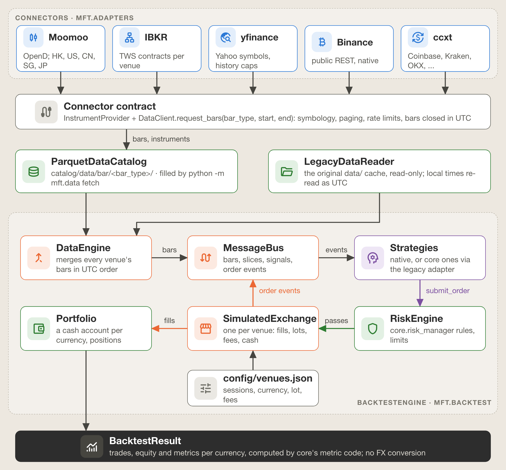

# mft: a venue-based trading engine

`src/mft/` is a second, venue-based framework that sits beside the original `src/core/`. It is
modelled on [NautilusTrader](https://nautilustrader.io): a trade happens on a **venue**, in an
**instrument**, from **bars** that know their source, through **orders** a risk engine can stop and
a venue can reject. It is our own implementation of those ideas, not the `nautilus_trader` library.

`core` is unchanged and still drives the live paper-trading engine and every reported result.
`mft` reuses it (the data providers, `core.risk_manager`, `core.portfolio`'s metric code) and can run
every `core` strategy unchanged, with identical results.



## Why a second engine

The original framework grew around one broker and one market at a time, and several things that a
multi-exchange system needs were implicit:

| In `core` | In `mft` |
|---|---|
| A symbol is a Moomoo string (`HK.00700`); the exchange, currency and trading hours are implied by the script | An `InstrumentId` (`00700.XHKG`) names the venue; the venue's spec gives its timezone, sessions, currency, lot rule and fees |
| Candle timestamps are the exchange's local clock labelled UTC | `ts_event` is the bar's close in true UTC nanoseconds, so markets in different timezones interleave correctly |
| `strategy.on_data` decides and fills in one call (`portfolio.execute_trade`) | A strategy submits an `Order`; the `RiskEngine` may deny it, the venue may reject it, fills come back as events |
| One `commission_rate` and one slippage wrapper per backtest | Fee and fill models per venue (HKEX 0.16%, US 0.005%, crypto maker/taker) |
| One cash balance | One cash account per currency (HKD, USD, USDT, ...) |
| Data providers return frames; each script knows its provider | Connectors share one contract and a registry picks the right one per venue |

## Concepts, and how they map to NautilusTrader

| `mft` | NautilusTrader | Notes |
|---|---|---|
| `model.identifiers`: `Venue`, `Symbol`, `InstrumentId`, `StrategyId`, `ClientId`, `ClientOrderId` | same names | Venues are ISO 10383 MICs (XHKG, XNAS, XNYS, XSES, XSHG, XSHE, XTKS) or crypto exchange names (BINANCE, COINBASE, KRAKEN, OKX). `InstrumentId.from_str` splits on the last dot, so `BRK.B.XNYS` works |
| `model.instruments`: `Equity`, `CurrencyPair` | `Equity`, `CurrencyPair` | Price increment, board lot or size step, minimum notional, currency. `make_qty` rounds down to a tradable amount |
| `model.data`: `BarSpecification`, `BarType`, `Bar` | same | `BarType` string form `00700.XHKG-1-HOUR-LAST-EXTERNAL`; `ts_event` = bar close, `ts_init` = creation time, both UTC ns. Prices are floats (Nautilus uses fixed point) |
| `model.orders`: `Order`, `OrderFactory`; `model.enums` | same | MARKET and LIMIT; GTC, DAY, IOC |
| `model.events`: `OrderSubmitted`, `OrderAccepted`, `OrderDenied`, `OrderRejected`, `OrderCanceled`, `OrderFilled` | same | Denied = stopped by the risk engine; rejected = refused by the venue |
| `model.signals.Signal` | `Signal` (custom data) | `value` may be an immutable ranking, not only a scalar |
| `model.fees`: `PercentFeeModel`, `MakerTakerFeeModel` | `FeeModel` | |
| `venues.VenueSpec` + `config/venues.json` | venue config of `BacktestVenueConfig` | Adds sessions, lot rule and per-connector symbol rules |
| `adapters.base`: `Connector`, `ConnectorConfig`, `ConnectorCapabilities`, `InstrumentProvider`, `DataClient`, `ExecutionClient` (slot only) | `adapters/`: `InstrumentProvider`, `DataClient`, `ExecutionClient`, factories | See "Connectors" |
| `adapters.registry.ConnectorRegistry` | client factories in a node config | The default connector per venue comes from `config/venues.json` |
| `persistence.ParquetDataCatalog` | `ParquetDataCatalog` | `catalog/data/bar/<bar_type>/*.parquet`, `catalog/instruments/*.json` |
| `common.msgbus.MessageBus` | `MessageBus` | Topic pub/sub with `*` and `?` wildcards; synchronous |
| `cache.Cache` (strategies get a read-only view) | `Cache` | |
| `backtest.DataEngine` | `DataEngine` | k-way heap merge of all bar streams in UTC order |
| `backtest.SimulatedExchange` | `SimulatedExchange` | One per venue |
| `backtest.models.FillModel` | `FillModel` | Here it also chooses the fill timing (bar close or next bar's open) |
| `risk.RiskEngine` | `RiskEngine` | Rules from `core.risk_manager` |
| `execution.ExecutionEngine` | `ExecutionEngine` | |
| `accounting`: `Account`, `Position`, `Portfolio` | `Account`, `Position`, `Portfolio` | Accounts are per currency, not per venue (see below) |
| `trading.Strategy` | `Strategy` | `on_start`, `on_bar`, `on_signal`, `on_order_filled`, `subscribe_bars`, `submit_order`, `order_factory`, `cache`, `portfolio` |
| `TimeSlice`, `Strategy.on_slice` | no equivalent | All bars sharing one `ts_event`, for cross-sectional decisions (the idea of LEAN's `Slice`) |
| `backtest.BacktestEngine`, `BacktestResult` | `BacktestEngine` | `add_venue`, `add_instrument`, `add_data`, `add_strategy`, `run` |
| `legacy.LegacyStrategyAdapter` | none | Runs `core.strategy` classes inside the engine |

Two deliberate differences from Nautilus:

- **Accounts are per currency, shared across venues.** Nautilus gives each venue its own account. Here
  XNAS and XNYS draw on one USD account, as they do at a real broker; a universe such as the S&P 100
  spans both exchanges and should not be split into two pots of cash. Funding the same currency twice
  is an error.
- **No FX conversion.** Results are reported per currency and never summed. A run with HKD and USD
  accounts gives two equity curves and two sets of metrics.

## Time

Every timestamp inside `mft` is an integer of nanoseconds since the epoch in UTC, and a bar's
`ts_event` is the time it **closed**. That is Nautilus's convention and also what Moomoo's `time_key`
means (a Hong Kong bar stamped 10:30 covers 09:30 to 10:30), so a strategy acting on a bar can never
see a price from after `ts_event`.

Sources stamp bars differently, and each connector converts:

| Source | Stamps a bar with | Converted by |
|---|---|---|
| Moomoo | close, exchange-local wall clock | reading it in the venue's timezone |
| yfinance, IBKR, Binance, ccxt | open, UTC | adding the interval, clamped to the session close (the Hong Kong bar opening 11:30 closes at 12:00 for lunch; the US bar opening 15:30 closes at 16:00) |
| any source, daily bars | the trading date | the last session close of that date (16:00 HKT = 08:00 UTC; 24:00 UTC for crypto) |

So one bar has the same `ts_event` whichever connector fetched it.

The original cache, `data/<MKT>_<CODE>/<tf>.parquet`, stores Moomoo's local close times labelled as
UTC (`moomoo_provider` calls `pd.to_datetime(time_key, utc=True)` on local strings). Within one market
this shifts every bar by the same offset, which is why the original single-market backtests were not
affected. Across markets it is wrong: a New York bar closing at 10:30 EDT (14:30 UTC) is stored as
10:30 and sorts before a Hong Kong bar closing at 11:30 HKT (03:30 UTC). `LegacyDataReader` re-reads
each file in its venue's timezone, and `VenueSpec.to_legacy_index` is the exact inverse, used to show
core strategies the timestamps they were written against.

## Venues: `config/venues.json`

Each venue has a timezone, trading sessions (HKEX's lunch break; `"24/7"` for crypto), currency,
lot-size rule, price increment, fee model, a default connector, and per connector the rules for
spelling its symbols. The fees for XHKG (0.16% all-in per side, calibrated against Moomoo paper fills
on 2026-07-09) and XNAS/XNYS (0.005% per side, Moomoo SG's schedule) are the ones the studies use; the
other venues' rates come from published schedules and are marked `"calibrated": false`.

Moomoo's `US` market does not say whether a stock is listed on Nasdaq or NYSE. The `listings` table in
the same file places a US symbol on XNAS or XNYS (default XNYS). Both venues share a timezone,
currency and fee model, so this only affects the instrument id.

```bash
cd src && python -m mft.data venues
```

## Connectors

A connector is everything source-specific in one place:

```python
class Connector:
    name: str                          # 'moomoo', 'ibkr', 'yfinance', 'binance', 'ccxt'
    config: ConnectorConfig            # retries, backoff, request spacing, plus source settings
    capabilities: ConnectorCapabilities  # intervals, history limits, historical/live/execution flags
    instrument_provider                # load(ids), load_all(venue) -> instruments with trading rules
    data_client                        # request_bars(bar_type, start, end) -> bars closed in UTC
    execution_client                   # None in this version
    def to_native(instrument_id) -> str
    def from_native(native, venue=None) -> InstrumentId
    def connect(); def close()
```

`DataClient.request_bars` checks the interval against `capabilities` (an unsupported one raises
`UnsupportedIntervalError`), moves a start beyond the source's history limit forward with a warning,
and returns bars sorted, without duplicates, within `[start, end]` and already closed.

| Connector | Wraps | Symbol for `00700.XHKG` / `AAPL.XNAS` | Paging | Rate limits |
|---|---|---|---|---|
| `moomoo` | `providers.moomoo_provider.MoomooProvider` (its OpenD context) | `HK.00700` / `US.AAPL` | 1,000 bars per page, `page_req_key` | frequency limit (60 requests per 30 s) retried with backoff; exhausted 30-day quota raises `QuotaExceededError` |
| `ibkr` | `providers.ib_provider.IBProvider` (a subclass sets the contract from the venue) | `700` on SEHK in HKD / `AAPL` on SMART, primary NASDAQ | windows inside IB's duration limits | spaced 10 s apart (60 per 10 min); pacing violations retried |
| `yfinance` | `providers.yfinance_provider.YFinanceProvider` | `0700.HK` / `AAPL` (`BRK-B` for `BRK.B`) | windows inside Yahoo's per-interval limits (1-minute: 7 days per request, 30 days back; hourly: 730 days back) | Yahoo's rate-limit error retried |
| `binance` | native, Binance public REST with `requests`, no API key | `BTCUSDT` | `/api/v3/klines`, 1,000 per call, by `startTime`; `/api/v3/exchangeInfo` for tick, step, min notional | HTTP 429 and 418 retried after `Retry-After` |
| `ccxt` | the `ccxt` library (optional) | `BTC-USD.COINBASE` -> `BTC/USD` | `fetch_ohlcv(since, limit)` | ccxt's own rate limiter; `RateLimitExceeded` retried |

What the wrappers fix in the providers they wrap, without modifying them:

- `MoomooProvider.get_historical_data` stops at the first error and returns the pages it already has,
  so a rate limit part-way through a download gives a silently truncated history. The connector pages
  itself and retries.
- `MoomooProvider` and `YFinanceProvider` answer a 4-hour request with hourly bars. Their connectors do
  not offer 4-HOUR.
- `IBProvider` builds every contract as `Stock(symbol, 'ISLAND', 'USD')` and asks for bar times in the
  TWS login's timezone, then labels them UTC. The connector sets the contract from the venue and
  requests UTC.

Adding a connector: subclass `Connector`, `DataClient` and `InstrumentProvider`; add the venue's
connector settings to `config/venues.json`; register it in `adapters/registry.py`; and add a case to
`tests/mft_engine/test_mft_connector_contract.py` with a fake transport that speaks the source's
format. The contract suite then checks symbol round-trips, pagination without gaps or duplicates,
UTC close times (including the HKEX lunch break and a US daylight-saving change), instrument specs,
unsupported intervals and venues, and rate-limit retry.

## Ingestion

```bash
cd src
python -m mft.data fetch --venue XHKG --symbols 00700 00005 --bar 1-HOUR --start 2024-01-01 --client moomoo
python -m mft.data fetch --venue XNAS --symbols AAPL MSFT --bar 1-DAY --start 2020-01-01 --client yfinance
python -m mft.data fetch --venue BINANCE --symbols BTCUSDT ETHUSDT --bar 1-HOUR --start 2024-01-01
python -m mft.data fetch --venue KRAKEN --symbols BTC-USD --bar 1-HOUR --start 2024-06-01 --end 2024-06-30
python -m mft.data fetch --venue XHKG --symbols 700 --bar 1-DAY --start 2024-01-01 --dry-run
python -m mft.data migrate --legacy-dir ../data --catalog ../catalog --timeframes 1h --dry-run
python -m mft.data catalog
```

Without `--client`/`--connector` the venue's default connector is used. A bare `--end` date means the
whole of that day. Bars and instrument definitions go to `catalog/` (it creates its own `.gitignore`
so market data is not committed). `migrate` copies the legacy cache into the catalog; it only reads
`data/` and refuses a catalog inside it.

## Backtesting

```python
from mft.backtest import BacktestEngine, FillModel
from mft.persistence import ParquetDataCatalog
from mft.strategies import MACrossover, MACrossoverConfig

catalog = ParquetDataCatalog("catalog")
engine = BacktestEngine()
engine.add_venue("XHKG", starting_balances={"HKD": 1_000_000}, fill_model=FillModel(slippage_bps=5))
engine.add_venue("XNAS", starting_balances={"USD": 100_000}, fill_model=FillModel(slippage_bps=5))
for inst in catalog.instruments():
    engine.add_instrument(inst)
hk, us = "00700.XHKG-1-HOUR-LAST-EXTERNAL", "AAPL.XNAS-1-HOUR-LAST-EXTERNAL"
engine.add_data(catalog.bars(hk))
engine.add_data(catalog.bars(us))
engine.add_strategy(MACrossover(MACrossoverConfig(bar_types=[hk, us], fast_period=5, slow_period=20)))
result = engine.run()
print(result.summary())          # per currency: HKD and USD
result.trades()                  # every fill, with the balance after it
```

For each timestamp the engine moves the clock, and for each bar lets the venue fill orders resting
from earlier bars, stores the bar, runs risk exits and publishes it; then it publishes the
`TimeSlice` and records equity per currency.

- **Fill models.** `FillModel(timing="close")` (default) fills a market order at the close of the bar
  it was decided on, plus slippage, as `core.backtester` does. `timing="next_open"` fills at the
  instrument's next bar's open, which removes the assumption that one can trade at the price that
  triggered the decision. Limit orders rest and fill when a later bar trades through the limit (at the
  limit as maker, or at the open as taker if the bar gaps through). DAY orders expire when the venue's
  local date rolls over.
- **Venue rules.** Quantities are rounded down to whole board lots or size steps; orders below one lot
  or below a minimum notional are rejected; a buy the currency account cannot pay for, or a sell of
  more than is held (no short selling), is rejected.
- **Risk.** `RiskConfig(max_drawdown_pct=...)` uses `core.risk_manager.RiskManager.is_trading_halted`
  per currency: while halted, orders that add exposure are denied and reducing orders pass.
  `stop_loss_pct`, `trailing_stop_pct` and `take_profit_pct` apply `RiskManager.check_exit_signals` to
  every open position on every bar, and the exit order is sent on behalf of the strategy that owns the
  position. `max_order_notional` and `max_position_pct` are plain pre-trade limits.
- **Results.** `BacktestResult` holds the fills, the orders, an equity curve per currency, and metrics
  per currency computed by `core.portfolio.Portfolio.calculate_metrics` plus `core.backtester`'s
  equal-weight benchmark, so a Sharpe ratio means the same thing from either engine.

## Running core strategies unchanged

```python
from mft.legacy import run_legacy_backtest
from core.strategy import CrossSectionalReversal

run = run_legacy_backtest(CrossSectionalReversal, sp100_symbols, "1h", "data",
                          initial_cash=100_000, commission_rate=0.00005, slippage_bps=5,
                          lookback=30, top_n=3, rebalance_every=19)
run.metrics        # the dict core.backtester.Backtester.run returns
run.result         # the engine's own BacktestResult for the same run
```

`LegacyStrategyAdapter` gives a core strategy a `LegacyPortfolio`, a real `core.portfolio.Portfolio`
subclass whose `execute_trade` becomes a market order through the risk engine and the venue. The venue
runs a `LegacyFillModel`: it fills at the price the strategy passed, with the original slippage
wrapper's arithmetic, commission = value x rate, and no lot rounding (the original backtester traded
odd lots). The trade is then booked by the original `Portfolio.execute_trade`, so the strategy sees
cash and positions change exactly as before; if the engine and the original bookkeeping ever disagree
about a trade, `LegacyDivergenceError` stops the run. Candles reach the strategy with the original
local-time timestamps.

Evidence (`tests/mft_engine/test_mft_legacy_equivalence.py`, and with `MFT_SLOW=1`
`test_mft_legacy_real_data.py`):

- For all 13 strategies in `STRATEGY_REGISTRY`, on synthetic Hong Kong hourly data, US hourly data
  across a daylight-saving change with a risk manager, and US daily data with equal-dollar sizing:
  identical trade lists (every field), final equity, metrics and equity curves, compared with `==`;
  the engine's own cash balance equals the original's to the last bit.
- On the real cache: all 13 strategies on five Hong Kong and five US stocks over 2025; the full S&P 100
  history (528,692 bars, 2,828 trades); and the forward test's configuration on the window it was
  chosen on, which reproduces the in-sample return (54.21160599596979%) and Sharpe ratio stored in
  `config/sp100_forward_test.json` digit for digit. The new engine is about twice as fast.

Limitations of the adapter, by construction: a core strategy has one cash balance, so its symbols
must settle in one currency; and it groups "the same timestamp" by local-time stamps, so mixing
venues in different timezones in one legacy strategy is not meaningful.

## Native strategies (`mft.strategies`)

- `MACrossover`: the moving-average crossover rule, expressed as orders. Same trades and final equity
  as `core.strategy.MovingAverageCrossover`.
- Cross-sectional reversal as two parts that talk through a `Signal`:
  `CrossSectionalRanker` receives each complete `TimeSlice` and, when a rebalance is due, publishes
  the universe ranked by return over `lookback` bars; `EqualWeightBasket` turns the ranking into orders
  (sell what left the basket, buy new members at an equal share of equity net of costs;
  `select="bottom"` is reversal, `"top"` momentum). Either half can be replaced on its own. On the
  synthetic data it makes the same trades as `CrossSectionalReversal` and `CrossSectionalMomentum`;
  on the real S&P 100 history it reproduces all 2,828 of the core version's trades.

Differences from the core versions are deliberate: orders are rounded to whole board lots; a holding
missing from the current slice is valued at its last close rather than at zero; and because the
ranking runs at the end of a slice, the final slice of the data can rebalance, which the core
version, closing a cross-section only when the next one began, never reached (4 extra trades at the
end of the S&P 100 history).

## Not in this version

- Live trading: no `ExecutionClient` is implemented; live orders stay on `core.live_engine` and
  `core.order_gateway` until the forward test ends. `subscribe_bars` on a data client is reserved.
- FX conversion, margin, short selling, partial fills and order-book simulation.
- HKEX's price-dependent tick table (one price increment per venue is used).
- Calibrated fees for XSES, XSHG, XSHE, XTKS and the crypto venues.

## Tests

```bash
python -m pytest tests/ -q                       # default suite, hermetic and fast
MFT_SLOW=1 MFT_DATA_DIR=/path/to/data python -m pytest tests/mft_engine/test_mft_legacy_real_data.py -q -s
```

The `mft` tests live in `tests/mft_engine/`. They use fake transports, temporary directories and
synthetic data; they never touch the network, a broker gateway or the real `data/` directory (the
opt-in real-data test only reads it). The figure above is drawn by `docs/diagrams/mft_architecture.py`
with the report's diagram helpers.
