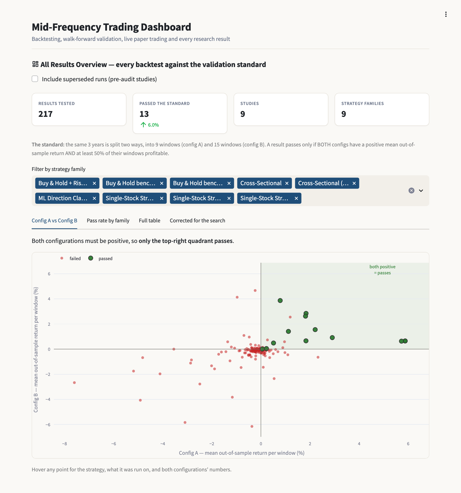
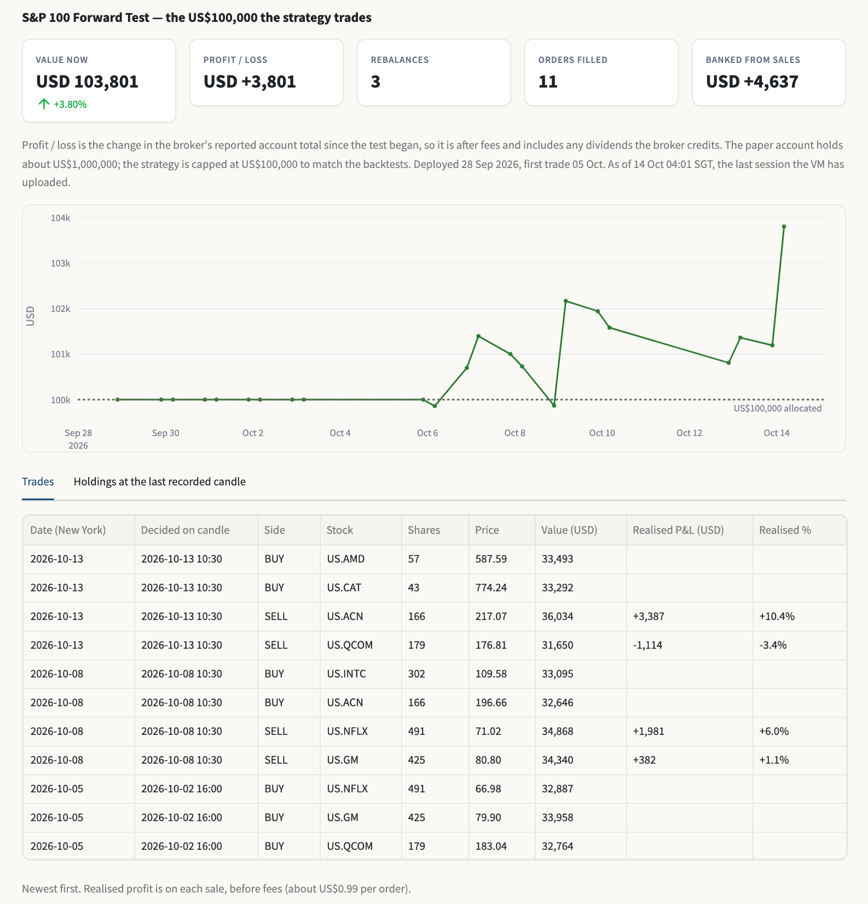
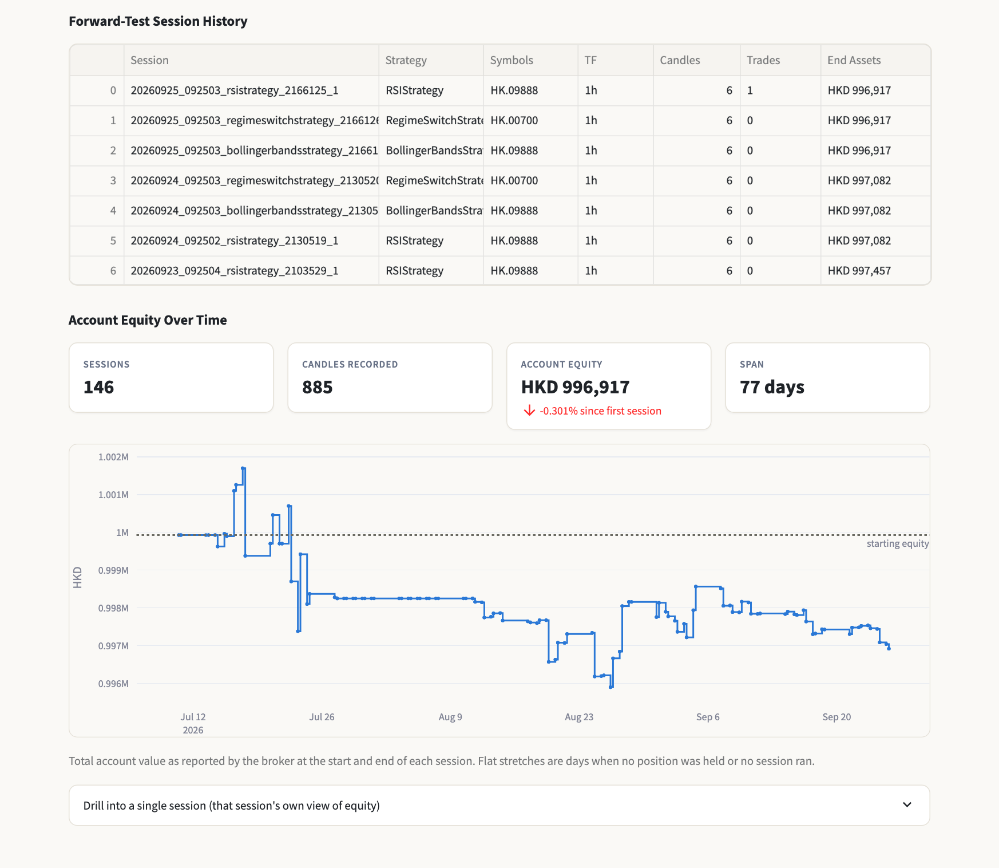
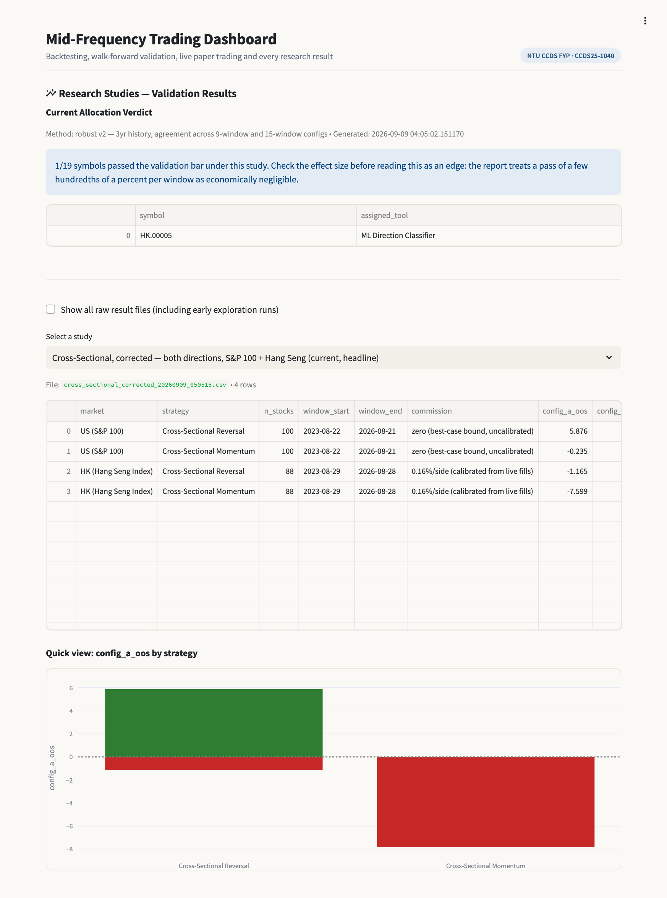

# Dashboard Guide

The dashboard is the interactive front end to this project: it runs backtests and walk-forward
optimisations, shows the live paper-trading accounts, and lays out every research result.
No code needs to be touched to use it.

## Starting it

```bash
git pull                                   # latest code and live-session logs
PYTHONPATH=src streamlit run src/app.py    # opens http://localhost:8501
```

If the dashboard was already running, stop it (Ctrl+C) and start it again after `git pull`.
A running dashboard keeps using the code it started with.

The **Live** view needs the moomoo OpenD gateway running and logged in on port 11111 to show
the broker's own account balance, positions and orders. Without it, that view still shows the
forward test's profit, trades and holdings from the recorded session logs, and every other view
works normally.

Running a new backtest needs the local price cache (`data/`), which is not in the repository.
The results, research and live views do not need it.

## Layout

- **Sidebar (left):** the controls — what to test and how.
- **Main area:** the results of whichever view was last opened.
- The **buttons at the foot of the sidebar** choose the view. Changing a setting does not re-run
  anything; press the button again.

## The views

| Button | What it does |
|---|---|
| **Run Backtest** | One strategy over one period: price chart with indicators, equity curve against buy-and-hold, and the full trade log. |
| **Compare All Strategies** | Every strategy on the selected stock with default settings, side by side. |
| **Run Optimization** | Grid search, or walk-forward — the validation method used throughout the project. |
| **Show Live Account & Sessions** | Either paper account (HK or US), its positions and orders, session history, and account equity over the whole deployment. |
| **All Results Overview** | Every result brought to the validation standard, on one chart. |
| **Browse Research Results** | The raw results file of any individual study. |

### All Results Overview — the best place to start



Each dot is one strategy tested on one stock or universe. The horizontal axis is its average
out-of-sample return under the 9-window split (Config A), the vertical axis under the 15-window
split (Config B). **A result passes only if both are positive and at least half of its windows
are profitable, so only the shaded top-right quadrant can pass.** Hover over any dot for the
details; the *Pass rate by family* tab summarises by strategy type.

The **Corrected for the search** tab shows what happened to the results that passed. Many
combinations were tried, and the best of many looks good by luck alone, so White's Reality
Check measures how often the best of 8 combinations with no edge at all would score as well
as the real winner. It does so about 1 time in 10, against the 1 in 20 needed to call a
result real. The tab also gives the Probability of Backtest Overfitting for S&P 100 reversal.

### Live paper trading

The selector at the top switches between the **Hong Kong** account (HKD) and the **US** account
(USD).

**US: the S&P 100 forward test.** This is the strategy trading live, shown from the session logs
the cloud VM uploads, so it needs no broker connection:



- **Value now** and **Profit / loss** are for the US$100,000 the strategy trades. The paper
  account itself holds about US$1,000,000; the strategy is capped at US$100,000 to match the
  backtests. The figure is the change in the broker's reported account total since the test
  began, so it is after fees and includes any dividends.
- **Rebalances** is how many times the strategy has re-ranked the 98 stocks and traded. It does
  this once every 19 hourly candles, which is about every 3 trading days.
- **Banked from sales** is the profit on positions already sold. The rest of the profit or loss
  is still in the stocks it holds.
- The **Trades** tab lists every order that filled, newest first, with the profit on each sale.
  *Decided on candle* is the hourly candle whose ranking produced the trade.
- The **Holdings** tab shows what it holds now, valued at the last recorded candle.

**Hong Kong: the earlier single-stock strategies**, which ran from July to September 2026:



The equity curve uses the account value reported by the broker at the start and end of each
session. Session logs are recorded on the cloud VM and uploaded daily at 16:15 SGT, so the
dashboard shows everything up to the last completed session once you run `git pull`. A session
that is still running, or finished after 16:15, appears the next day.

### Research studies



Studies are listed current-first. Anything marked *superseded* was produced before the
2026-09-08 audit corrected six defects in the testing code and should not be relied on.

## Sidebar controls

1. **Universe** — HK live roster (19), US 15 large caps, S&P 100, or Hang Seng Index (88). Sets
   the currency and the default commission.
2. **Symbol** — the stock, for single-stock strategies.
3. **Strategy** and its parameters.
4. **Timeframe** — keep **1 Hour**; all studies use hourly data, which exists for every symbol.
5. **Start / End date** and **Starting capital**.
6. **Risk Management** — stop-loss, trailing stop, take-profit, position sizing, drawdown halt.
7. **Execution Model** — slippage and **commission per side** (HK 0.160%, US 0.005% by default).
8. **Strategy Optimization** — grid search or walk-forward, number of windows, train fraction,
   and the objective (Sharpe ratio by default).

**Cross-sectional strategies** (reversal and momentum) rank stocks against each other, so they
always run on the **whole selected universe**, not just the chosen symbol, with money split
equally across the stocks held. A note appears above the results when this happens.

## A guided walkthrough

Set **Start Date** to 25 Sep 2025 and **End Date** to 25 Sep 2026 first. That is the last full
year in the price cache, and with those dates the results below are what you should see.

1. **A single-stock backtest.** Universe *US — S&P 100*, symbol *US.AAPL*, strategy
   *Z-Score Mean Reversion*, then **Run Backtest**. Expect 64 trades and a loss of 3.8%, while
   simply holding the stock made 34.8% (the *Benchmark* figure).
2. **The strategy that is trading live.** Strategy *Cross-Sectional Reversal*, then type in
   *Lookback* 30, *Basket Size* 3 and *Rebalance Every* 19, the settings of the live forward
   test, and **Run Backtest**. It runs on all 100 stocks. Expect +56.8% from 449 trades, with a
   largest fall of 20.5% along the way, against +24.9% for holding all 100 stocks equally.
3. **Cost sensitivity.** Keep step 2 and raise *Commission per side* from 0.005 to 0.160, the
   Hong Kong rate. The same 449 trades now return +24.8%: fees take more than half the profit.
4. **A walk-forward validation.** Universe *US — 15 large caps*, strategy *Cross-Sectional
   Reversal*, mode *Walk-Forward*, then **Run Optimization** (1–2 minutes). Expect an average of
   +17.7% on the data the settings were chosen on, and +3.5% on the data they had not seen.
5. **The whole record.** Open **All Results Overview**.
6. **The live test.** Open **Show Live Account & Sessions** and choose *United States*.

## Reading a single backtest

A single backtest over one period is not evidence of an edge. A profitable-looking backtest is
easy to find by trying settings until one works.

Step 2 above is the clearest example. Its +56.8% is not this project's result, because the
settings 30 / 3 / 19 were chosen on the last 84 days of that same year (3 July to 25 September
2026), so the backtest is partly scoring them on the data they were picked from. Step 4 shows
the size of that effect on another universe: +17.7% on the data used to choose the settings and
+3.5% on unseen data. Tested on unseen data across 3 years, S&P 100 reversal averages +5.7% and
+0.6% per window, and once the number of strategy and universe combinations tried is accounted
for (report §4.11), that cannot be told apart from chance.

That is why the project requires agreement across two walk-forward splits before a result
counts, and why the live forward test, not a backtest, is the only truly unseen result.

## Timing

| Action | Typical time |
|---|---|
| Backtest, single stock | ~1 s |
| Backtest, cross-sectional on the S&P 100 | ~5 s |
| Walk-forward, cross-sectional on US 15 / HK 19 | 1–2 min |
| Walk-forward, cross-sectional on the S&P 100 / Hang Seng | 10–15 min |
