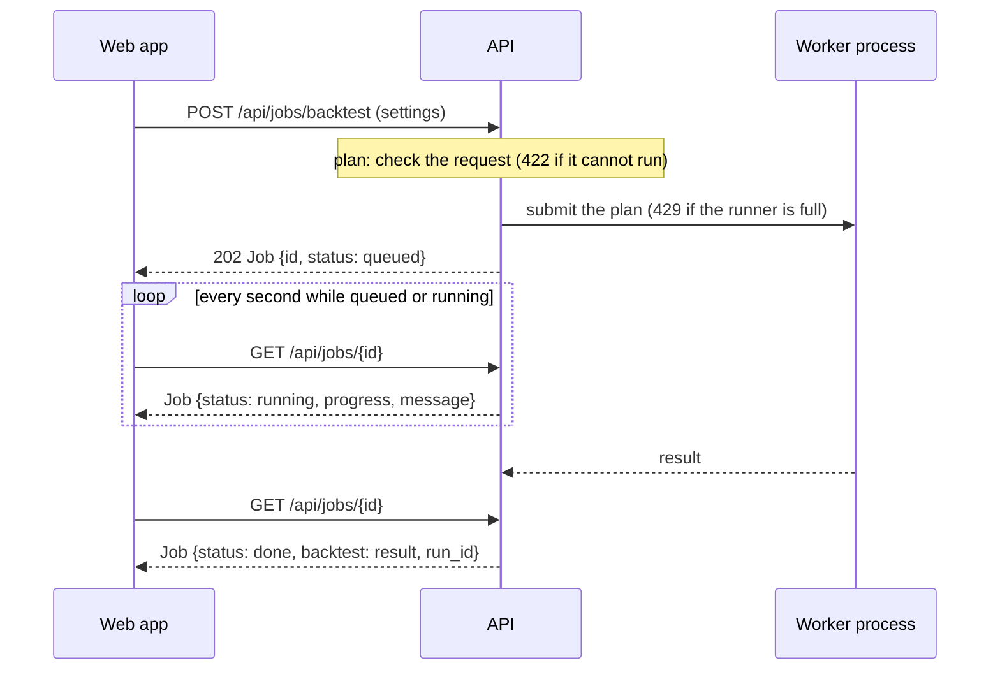

# HTTP API

The dashboard's HTTP API is a [FastAPI](https://fastapi.tiangolo.com/) service in
[`apps/api`](repo:apps/api/README.md) (the `midfreq-api` distribution, module `midfreq.api`). It
serves JSON to the web dashboard ([`apps/web`](repo:apps/web/README.md)) over research results,
the trading bot's record and broker accounts, and runs backtests on request. When the built web
app (`apps/web/dist`) is present, the same process also serves it at `/`, answering every path
that is not a file with `index.html` so that the app's own routes survive a reload; paths under
`/api/` are never answered from there.

```bash
uv run uvicorn midfreq.api.main:app --reload       # http://127.0.0.1:8000, interactive docs at /docs
uv run pytest -q -p no:cacheprovider apps/api       # its tests, in temporary folders only
```

The [reference](reference.md) documents every route, parameter and response model. This page
describes the design behind them.

## The contract

The response and request models in `schemas.py` are the contract between the API and the web
app. The API exports them as [`apps/api/openapi.json`](repo:apps/api/openapi.json)
(`uv run python -m midfreq.api.export_openapi`), and a test fails when that file is out of date.
The web app generates its TypeScript types from the same file (`npm run gen:api`, with
`openapi-typescript`) and calls the API through a client typed against them, so a route or field
the API does not declare does not compile. CI checks that the committed types match the
contract.

This site copies `openapi.json` into itself each time it is built, so the
[reference](reference.md) always shows the contract of the commit the site was built from.

The routes are split by subject into routers (`routers/`); `main.py` only assembles them, and the
seams that tests and deployments replace are FastAPI dependencies (`deps.py`): `get_settings`,
`get_record_store`, `get_account_provider`, `get_run_store`, the token verifier and the job
runner.

## Design

### Two sources, never merged

Live trading is shown from two independent sources, and no route combines them:

| Source | Read through | Routes |
|---|---|---|
| **The bot record**: the session logs (`session_*.jsonl`), console logs (`console_*.log`) and broker snapshots the bot and the VM write | a `RecordStore` (`store.py`): `LocalDirRecordStore` over a folder, or `GcsMirrorRecordStore` over a Cloud Storage bucket, mirrored into a local cache at most once a minute | `/api/forward-test`, `/api/sessions`, `/api/sessions/{session_id}` |
| **Each broker or exchange account**, as the venue reports it | an `AccountProvider` (`account_provider.py`) over the read-only `AccountClient` of each entry in the `accounts` section of `config/connections.yaml` | `/api/accounts`, `/api/accounts/{account_id}` |

The web app shows them in separate, labelled panels, so that one can be checked against the
other: a fill in the bot record should appear among the broker's orders, and the bot's holdings
among its positions. The API never talks to the trading bot process. A record store only lists
and reads files by name, and refuses an id that is not in its own listing, which keeps a request
from naming a path outside the record.

### Read-only accounts

An account is read through its connector's `AccountClient` (`midfreq.data.adapters`), which
offers `available()`, `snapshot()`, `positions()` and `orders()` and never places, changes or
cancels anything. Exchange API keys are never in the configuration file: an entry names the
environment variables that hold them, and the keys are expected to be read-only.

Only the trading VM can reach the broker's gateway, moomoo OpenD. The VM therefore publishes each
account marked `publish: true` every 5 minutes as `broker_<id>.json` beside the session logs
([Broker snapshots](../../concepts/live_trading.md#broker-snapshots)), and the record store reads
those files too. Each account is served with a `kind`:

| `MIDFREQ_DASHBOARD_ACCOUNTS` | Where | Accounts served |
|---|---|---|
| `on` (default) | a laptop, the VM | `live`, read through the gateway now; an account whose gateway cannot be read is served from its snapshot if there is one |
| `snapshots` | the hosted dashboard | `snapshot`: only the configured accounts that have a published snapshot, with `as_of` its read time; no gateway is ever probed |
| `off` | anywhere | none |

`GET /api/accounts` probes every account in parallel, each bounded by a short timeout, so the
list never hangs on a gateway that is down. `GET /api/accounts/{account_id}` answers 404 for an
unknown account and 503, with the reason, for one that cannot be read now and has no readable
snapshot.

### Jobs

Backtests, comparisons and optimizations (grid search or walk-forward) run as background jobs,
so that a long walk-forward does not hold a request open:



- **Planning.** `runs.plan` checks everything that can be checked before a run starts (the
  strategy and its parameter ranges, symbols with cached candles, the universe of a
  cross-sectional strategy, dates and costs) and answers 422 with a one-sentence reason. A
  kind the deployment does not allow (`Settings.job_kinds`) is 403. A run that fails after it has
  started becomes a job with status `failed` and the reason in `error`.
- **One stock or one universe.** A single-stock strategy needs a `symbol`; a cross-sectional
  strategy takes a `universe` and no symbol, and the universe must hold more stocks with cached
  candles than its basket (for a search, than the largest basket its grid tries). A comparison is
  of single-stock strategies on one stock, or of cross-sectional strategies on one universe,
  never both: the two kinds trade different stocks, size their positions differently and are
  measured against different buy and hold, so their rows would not be like-for-like.
- **Buy and hold.** A backtest's and a comparison's result carries `benchmark`: the starting
  capital split equally across the stock or the universe's stocks at their first close in the
  run's dates and held, valued over time. Its last value gives the run's buy-and-hold return,
  from which `alpha` is measured. A cross-sectional backtest has no `chart`, since it trades no
  one stock.
- **Execution.** Runs make the same library calls with the same arguments as the Streamlit
  dashboard's sidebar did, so the same inputs give the same numbers. They run in worker
  processes at a lower priority than the API, so the API keeps answering while a run computes.
  At most `max_concurrent_jobs` run at once (1 by default); another request gets 429.
- **Registry.** Jobs are held in the API process's memory: the most recent 50, with their
  results. Restarting the server forgets them, and each server process has its own, so the API
  runs as one uvicorn worker.
- **Capabilities.** `GET /api/jobs/capabilities` tells the web app what this deployment allows:
  the run kinds, how many at once, the optimization objectives, and per market the default
  commission, currency, symbols with cached data and universes. The hosted dashboard allows
  backtests and comparisons, one at a time.

### Run store

Each finished job is also saved to the run store ([Saved runs](../../concepts/saved_runs.md)),
and the job reports the saved run's id as `run_id`. The save runs after the work, in a thread of
its own; a save that fails is logged and the job is still `done`, without a `run_id`.

| Route | Returns |
|---|---|
| `GET /api/runs?kind=&strategy=&limit=` | saved runs, newest first, with their headline metrics |
| `GET /api/runs/{run_id}` | one run: its summary, its `run.json` and the names of its tables |
| `GET /api/runs/{run_id}/tables/{name}?format=` | one table: JSON rows (`json`, the default), or a `csv` or `parquet` file |
| `DELETE /api/runs/{run_id}` | removes a run; 403 where deleting is not allowed, as on the hosted dashboard |

A store that cannot be reached (no credentials for the bucket) makes these routes answer 503
with the reason; jobs still run, unsaved.

### Research results and reference data

- `GET /api/results/overview` stacks every result held to the two-configuration standard
  (`midfreq.research.results_index`) and adds the correction for the search (White's Reality
  Check p-values and the PBO).
- `GET /api/research/files` lists the CSV and JSON files in `results/`, newest first;
  `GET /api/research/files/{name}` returns one, a CSV as columns and rows (NaN as `null`, up to
  `limit` rows) and a JSON file parsed.
- `GET /api/strategies` gives each registered strategy's parameters with label, default,
  minimum, maximum and step; `GET /api/universes` the universes in `config/symbols.json`;
  `GET /api/candles` candles from the price cache.

<!-- include: apps/api/README.md#sign-in level=3 -->

## Conventions

- **Times** are UTC. The bot stamps a session's start and end with the VM's clock (Singapore
  time) and no zone; the API converts them. Candle and trade times are returned as the bot and
  the cache recorded them.
- **Errors** are FastAPI's JSON body, `{"detail": ...}`: a sentence for the API's own errors, a
  list of problems for request validation. The status codes used:

    | Code | Meaning |
    |---|---|
    | 401 | sign-in is on and the request has no valid token |
    | 403 | an account not on the access list; a run kind, or deleting a run, that this deployment does not allow |
    | 404 | no such session, account, job, run, table or file; no forward test recorded; candles not cached |
    | 422 | a request that fails validation, or a run that cannot be done as asked |
    | 429 | as many runs as the server allows are already queued or running |
    | 501 | a route declared in the contract but not implemented yet |
    | 503 | an account, the run store, Google's signing keys or another source that cannot be read now |

- **CORS** allows the web app's development server (`http://localhost:5173` and
  `http://127.0.0.1:5173`); in production the web app is served from the API's own origin.

## Configuration

`Settings` (`settings.py`) holds every folder and limit the routes use. The defaults come from
`midfreq.core.paths`, and environment variables adapt them to a deployment:

| Variable | Sets | Default |
|---|---|---|
| `MIDFREQ_ROOT` | the root of `config/`, `data/`, `results/` and `live_sessions/` | the repository |
| `MIDFREQ_LIVE_SESSIONS` | the bot record: a folder, or `gs://bucket/prefix` | `live_sessions/` |
| `MIDFREQ_DASHBOARD_ACCOUNTS` | `on`, `snapshots` or `off` (above) | `on` |
| `MIDFREQ_DASHBOARD_JOBS` | the run kinds allowed, comma-separated | `backtest,compare,optimize` |
| `MIDFREQ_DASHBOARD_MAX_JOBS` | runs at once | `1` |
| `MIDFREQ_DASHBOARD_RUN_DELETE` | whether saved runs may be deleted | `on` |
| `MIDFREQ_RUNS` | the run store: a folder, or `gs://bucket/prefix` | `runs/` |
| `MIDFREQ_AUTH` and the other `MIDFREQ_AUTH_*` variables | sign-in ([above](#sign-in)) | `off` |

Tests and other deployments can also pass a `Settings` to `create_app`, or replace any
dependency with `app.dependency_overrides`.

## Routes

<!-- openapi-routes: service; auth; bot record; accounts; research; reference; runs; run history -->

Request bodies, parameters and response models are in the [reference](reference.md).
