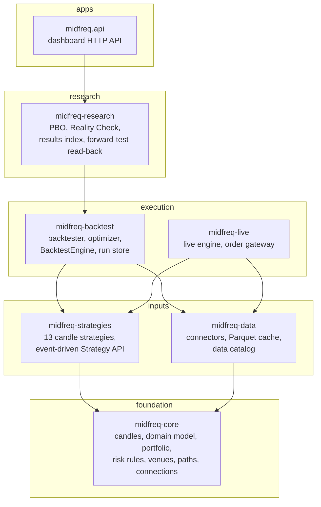
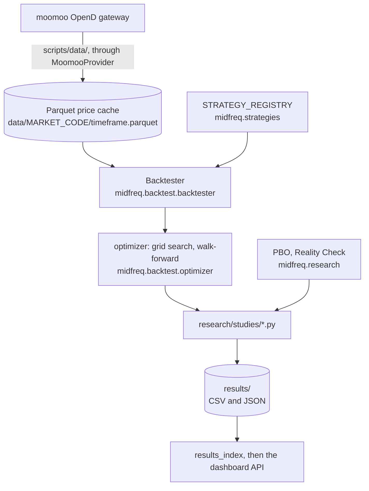
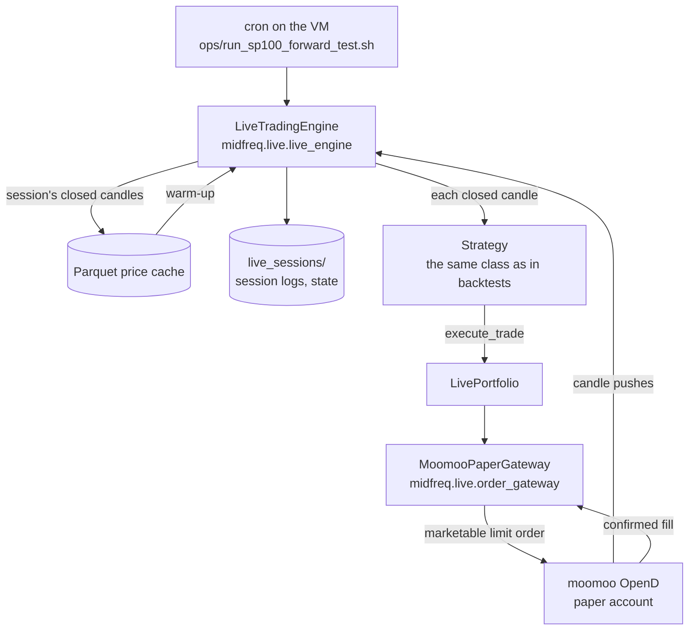

# Architecture overview

The repository is a [uv](https://docs.astral.sh/uv/) workspace. Its library code is six
installable packages, all contributing to one `midfreq` namespace (`midfreq.core`,
`midfreq.data`, and so on). Around them sit the applications that use them, the research studies,
and the operations scripts:

| Folder | What it holds |
|---|---|
| [`packages/`](repo:packages) | The six packages, each with its own `tests/` |
| [`apps/api`](repo:apps/api) | The dashboard's HTTP API (FastAPI, `midfreq.api`); see [API](../api/index.md) |
| [`apps/web`](repo:apps/web) | The dashboard (React and TypeScript), a client of that API; see [Dashboard](../dashboard.md) |
| [`apps/dashboard`](repo:apps/dashboard) | The earlier Streamlit dashboard, kept until it is removed |
| [`apps/live_runner`](repo:apps/live_runner) | `run_live.py`, which starts the live engine from a checkout |
| [`research/studies/`](repo:research/README.md) | One script per study; each writes its result to `results/` |
| [`ops/`](repo:ops) | The VM's session launchers, release build and deploy scripts; see [Deployment](../deployment.md) |
| [`scripts/`](repo:scripts) | Data download and refresh, live-trading checks, cost calibration, tools |
| [`config/`](repo:config) | Stock universes, venues, connection settings, the forward test's configuration |
| [`results/`](repo:results) | Study outputs (CSV and JSON) that the dashboard reads |
| `data/` | The local Parquet price cache; not in the repository |

## Packages and their layers

A package may import only the packages below it. The rule is declared as an
[import-linter](https://import-linter.readthedocs.io/) contract in the root
[`pyproject.toml`](repo:pyproject.toml) and checked by `uv run lint-imports` in CI. Packages that
share a layer are independent: `midfreq.live` and `midfreq.backtest` may not import each other,
nor may `midfreq.strategies` and `midfreq.data`.

Arrows are declared dependencies; a dependency implied by a longer path (every package depends
on `midfreq-core`, for example) is not drawn. Nothing imports `midfreq-live` except the live
runner and the scripts, and nothing imports `midfreq-research` except the studies, the dashboards
and the presentation scripts.

| Package | Layer | Depends on | Holds |
|---|---|---|---|
| [midfreq-core](../packages/midfreq-core.md) | 1 | no other `midfreq` package | `Candle` and `Timeframe`; the venue, instrument, order and event model; portfolio and risk rules; venues; repository paths; connection settings |
| [midfreq-data](../packages/midfreq-data.md) | 2 | core | Connectors (Moomoo, IBKR, yfinance, Binance, ccxt), the Parquet bar cache and data catalog, read-only account clients, `python -m midfreq.data` |
| [midfreq-strategies](../packages/midfreq-strategies.md) | 2 | core | The 13-strategy candle library and its registry; the event-driven Strategy API and native strategies |
| [midfreq-backtest](../packages/midfreq-backtest.md) | 3 | core, data, strategies | The candle backtester and walk-forward optimizer; the event-driven `BacktestEngine` with fill and slippage models; the run store |
| [midfreq-live](../packages/midfreq-live.md) | 3 | core, data, strategies | The live trading engine and the broker order gateway |
| [midfreq-research](../packages/midfreq-research.md) | 4 | core, data, strategies, backtest | Probability of Backtest Overfitting, White's Reality Check, the results index, the forward-test read-back |
| `midfreq.api` (`apps/api`) | 5 | all but live | The dashboard's HTTP API |

The same strategy classes run everywhere: the backtester, the optimizer, the dashboard and the
live engine all take them from `STRATEGY_REGISTRY` in `midfreq.strategies.candle_strategies`.

## Research data flow

Every study uses moomoo data, the same source the live engine trades on.

1. **Download.** The scripts in [`scripts/data/`](repo:scripts/data) pull candles from moomoo
   OpenD through `MoomooProvider` and store them with `DataStorage`
   (`midfreq.data.storage`), one Parquet file per symbol and timeframe:
   `data/<MARKET>_<CODE>/<timeframe>.parquet`, for example `data/HK_00700/1h.parquet`. Every
   file has the same schema: a `timestamp` index (the candle's end time in the exchange's local
   time, stored with a UTC label) and `open`, `high`, `low`, `close` and `volume`.
2. **Backtest.** `Backtester` (`midfreq.backtest.backtester`) replays the cached candles through
   a strategy, candle by candle. A strategy trades by calling `portfolio.execute_trade(...)`;
   the portfolio (`midfreq.core.portfolio`) and the risk manager (`midfreq.core.risk_manager`)
   apply per-market fees (Hong Kong 0.16% per side all-in, calibrated against the broker's paper
   fills; US 0.005% per side, from the broker's fee schedule), slippage, board lots, stop-loss, trailing stop, take-profit, position sizing and a drawdown
   halt.
3. **Validate.** `midfreq.backtest.optimizer` runs grid searches and walk-forward optimizations
   over the registry's parameter ranges. The studies in
   [`research/studies/`](repo:research/README.md) combine these with
   `midfreq.research.overfitting` (PBO, by combinatorially symmetric cross-validation) and
   `midfreq.research.reality_check` (White's Reality Check with the stationary bootstrap).
4. **Record.** Each study writes a timestamped CSV or JSON file to `results/`. The report's
   numbers come from these files, which are committed.
5. **Serve.** `midfreq.research.results_index` stacks every two-configuration study into one
   table (the newest run of each study, superseded studies left out), which the API serves to the
   dashboard's Overview page. The dashboard can also run new backtests, comparisons and
   optimizations on the same cache through the API's [jobs](../api/index.md#jobs).

## Live trading path

The live engine runs on a Google Cloud virtual machine (the *trading VM*) beside the moomoo OpenD
gateway, on the paper-trading account. Cron starts one session each US trading day; see
[Deployment](../deployment.md#the-trading-vm) for the schedule.

- **Candles.** OpenD pushes an update each time the forming candle changes. A candle is final
  only when a push arrives with a newer timestamp; the previous candle is then passed to the
  strategy, which gives the same one-decision-per-closed-candle rhythm as the backtester. At the
  start of a session the engine warms up from the local Parquet cache, and falls back to the
  broker's metered historical API only for candles the cache lacks. At the end it writes the
  session's closed candles back into the cache.
- **Orders.** Strategies are unchanged from backtesting. `LivePortfolio` intercepts
  `execute_trade`, and `MoomooPaperGateway` submits a marketable limit order, waits for the fill
  and cancels any remainder. Only fills the broker confirms are recorded. Several strategies may
  share one paper account, so each portfolio claims only the positions it opened.
- **State and logs.** Each session writes a JSON-lines log (`session_*.jsonl`) and its console
  output (`console_*.log`) to `live_sessions/`, and keeps the strategy's state
  (`state_*.json`, for example the rebalance clock and positions) between daily sessions.
- **Paper only.** OpenD's address and trading environment come from the `moomoo` entry of
  `config/connections.yaml`, which is the paper environment (`trading_env: simulate`). Real money
  would be used only if that entry, or `MIDFREQ_MOOMOO_TRADING_ENV`, said `real` explicitly.

### Two sources, never merged

The dashboard shows live trading from two independent sources side by side, so that one can be
checked against the other:

- **The bot record**: what the bot wrote in its session logs. On the VM, these are uploaded to
  a private Cloud Storage bucket every 2 minutes, from which the hosted dashboard mirrors them.
- **The broker account**: what the broker reports. Only the VM can reach OpenD, so the VM also
  reads each published paper account every 5 minutes, read-only, and writes it as a snapshot
  (`broker_<id>.json`) beside the session logs.

A fill in the bot record should appear among the broker's orders, and the bot's holdings among
the broker's positions; a difference would point to a fault in the bot's record keeping. The
[API](../api/index.md#two-sources-never-merged) keeps the two apart in its routes as well.

## The venue-based engine

A second engine, modelled on [NautilusTrader](https://nautilustrader.io), sits beside the
candle backtester without changing it. Trading happens on explicit **venues** (XHKG, XNAS, XNYS,
XSES, XSHG, XSHE, XTKS, and the crypto exchanges BINANCE, COINBASE, KRAKEN and OKX), in
**instruments** such as `00700.XHKG`, from **bars** whose timestamp is their close in true UTC,
through **orders** that a risk engine can deny and a simulated venue can reject. Each venue's
timezone, sessions, currency, board-lot rule and fees are in
[`config/venues.json`](repo:config/venues.json).

Its parts are spread over the same packages: the model, venues, message bus and accounts in
`midfreq-core`; the connectors, the data catalog and the `fetch` command in `midfreq-data`; the
Strategy API and native strategies in `midfreq-strategies`; and the engine, simulated venues, fill
and slippage models and the legacy adapter in `midfreq-backtest`. Every candle strategy runs in it
unchanged through the legacy adapter, with trade lists and final equity identical to the candle
backtester.

Live trading stays on the candle engine (`midfreq-live`) until the forward test ends. The
[venue-based engine](engine.md) page describes the design in full and how it maps to
NautilusTrader.
