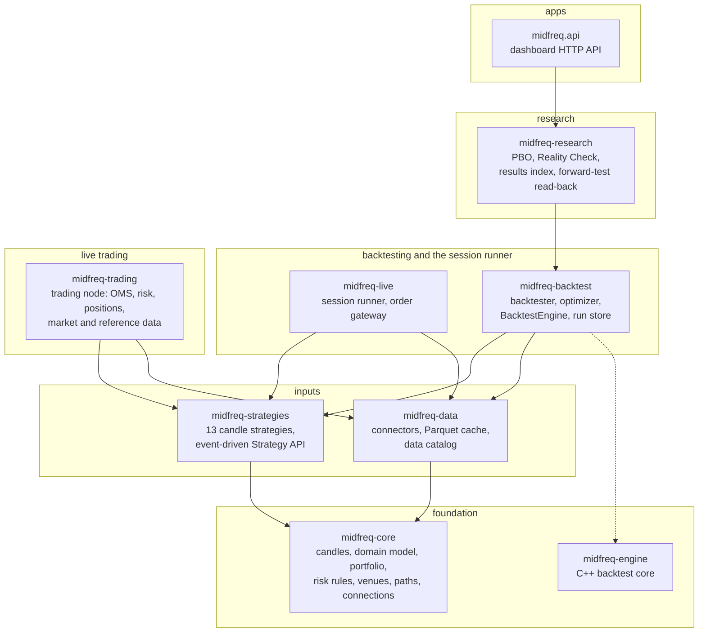
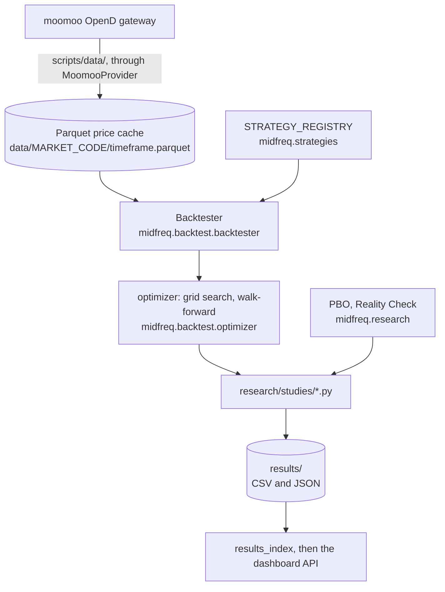

# Architecture

The repository is a [uv](https://docs.astral.sh/uv/) workspace. Its library code is eight
installable packages, all contributing to one `midfreq` namespace package (PEP 420), so code
imports `midfreq.core`, `midfreq.data` and so on whichever distribution provides them: seven in
pure Python, and `midfreq-engine`, the candle backtester's C++ core with its Python bindings.
Around them sit the applications that use them, the research studies and the operations scripts.

| Folder | What it holds |
|---|---|
| [`packages/`](repo:packages) | The eight packages, each with its own `pyproject.toml` and `tests/` |
| [`apps/api`](repo:apps/api) | The dashboard's HTTP API (FastAPI, `midfreq.api`); see [HTTP API](../api/http/index.md) |
| [`apps/web`](repo:apps/web) | The dashboard (React and TypeScript), a client of that API; see [The dashboard](dashboard.md) |
| [`apps/live_runner`](repo:apps/live_runner) | `run_live.py`, which starts the session runner from a checkout |
| [`research/studies/`](repo:research/README.md) | One script per study; each writes its result to `results/` |
| [`ops/`](repo:ops) | The trading VM's session launchers (the trading node's and the session runner's), its schedule and startup checks, the release build and deploy scripts |
| [`scripts/`](repo:scripts) | Data download and refresh, live-trading checks, cost calibration, tools |
| [`config/`](repo:config) | Stock universes, venues, connection settings, the forward test's configuration, the trading node's configurations |
| [`results/`](repo:results) | Study outputs (CSV and JSON) that the dashboard reads |
| `data/` | The local Parquet price cache; not in the repository |

## Packages and their layers

A package may import only the packages below it. The rule is declared as an
[import-linter](https://import-linter.readthedocs.io/) contract in the root
[`pyproject.toml`](repo:pyproject.toml) and checked by `uv run lint-imports` in CI. Packages that
share a layer are independent: `midfreq.live` and `midfreq.backtest` may not import each other,
nor may `midfreq.strategies` and `midfreq.data`, nor `midfreq.core` and `midfreq.engine`. A
second rule, that only the connectors import a venue's SDK, is checked by a test
([Integrations](../integrations/index.md#trading-through-connectors)).

Arrows are declared dependencies; a dependency implied by a longer path (every package depends
on `midfreq-core`, for example) is not drawn. The dotted arrow is optional: `midfreq.backtest`
runs on the C++ engine when it is installed and on Python otherwise. Nothing imports
`midfreq-live` or `midfreq-trading`: they run as their own commands (`midfreq-live`,
`midfreq-node`) and from the launchers and scripts. Nothing imports `midfreq-research` except the
studies, the dashboards and the presentation scripts.

| Package | Layer | Depends on | Optional extras | Holds |
|---|---|---|---|---|
| [midfreq-core](../api/python/midfreq/core/index.md) | 1 | no other `midfreq` package | | `Candle` and `Timeframe`; the venue, instrument, order and event model; portfolio and risk rules; venues; repository paths; connection settings |
| [midfreq-engine](../api/python/midfreq/engine/index.md) | 1 | no other `midfreq` package | | The candle backtester's C++17 core and eleven candle strategies in C++, through pybind11 ([The C++ engine](native_engine.md)) |
| [midfreq-data](../api/python/midfreq/data/index.md) | 2 | core | `moomoo`, `ibkr`, `yfinance`, `crypto` | Connectors (Moomoo, IBKR, yfinance, Binance, ccxt) with their execution clients and live streams, the Parquet price cache and data catalog, read-only account clients, `python -m midfreq.data` |
| [midfreq-strategies](../api/python/midfreq/strategies/index.md) | 2 | core | `hmm` | The 13-strategy candle library and its registry; the event-driven Strategy API and native strategies |
| [midfreq-trading](../api/python/midfreq/trading/index.md) | 3 | core, data, strategies | | The trading node: OMS and order journal, pre-trade risk, position ledger, market data and reference data services, the strategy host, the simulated venue; the `midfreq-node` command ([The trading node](trading_node.md)) |
| [midfreq-backtest](../api/python/midfreq/backtest/index.md) | 4 | core, data, strategies | | The candle backtester and optimizer; the event-driven `BacktestEngine` with fill and slippage models; the run store |
| [midfreq-live](../api/python/midfreq/live/index.md) | 4 | core, data, strategies | | The session runner and its Moomoo order gateway; the `midfreq-live` command |
| [midfreq-research](../api/python/midfreq/research/index.md) | 5 | core, data, strategies, backtest | | Probability of Backtest Overfitting, White's Reality Check, the results index, the forward-test read-back |
| `midfreq.api` (`apps/api`) | 6 | core, data, strategies, backtest, research | | The dashboard's HTTP API |

The same strategy classes run everywhere: the backtester, the optimizer, the dashboard, the
session runner and the trading node all take them from `STRATEGY_REGISTRY` in
`midfreq.strategies.candle_strategies`.

In a checkout, `uv sync` installs every package in editable mode. On the trading VM the seven
Python packages are installed from the wheels of a versioned release, and every package carries
the same version ([Releases and deployment](../developer_guide/releases_and_deployment.md)).

## Research data flow

Every study uses moomoo data, the same source the live sessions trade on.

1. **Download.** The scripts in [`scripts/data/`](repo:scripts/data) pull candles from moomoo
   OpenD and store them with `DataStorage` (`midfreq.data.storage`), one Parquet file per symbol
   and timeframe ([Data and connectors](data.md#the-price-cache)).
2. **Backtest.** `Backtester` replays the cached candles through a strategy, candle by candle,
   with each market's fees, slippage and the risk rules ([Backtesting](backtesting.md)).
3. **Validate.** `midfreq.backtest.optimizer` runs grid searches and walk-forward optimizations
   over the registry's parameter ranges. The studies in
   [`research/studies/`](repo:research/README.md) combine these with the Probability of
   Backtest Overfitting and White's Reality Check
   ([Optimization and validation](optimization_and_validation.md)).
4. **Record.** Each study writes a timestamped CSV or JSON file to `results/`. The report's
   numbers come from these files, which are committed.
5. **Serve.** `midfreq.research.results_index` stacks every two-configuration study into one
   table, which the API serves to the dashboard's Overview page. The dashboard can also run new
   backtests, comparisons and optimizations on the same cache.

The live paths, from the broker's pushes to confirmed fills, are described under
[Live trading](live_trading.md) and [The trading node](trading_node.md).

## The venue-based engine

<!-- include: docs/ARCHITECTURE.md strip-title intro-only -->

The rest of this section is from the same design document,
[`docs/ARCHITECTURE.md`](repo:docs/ARCHITECTURE.md). Its other sections are shown with the
concepts they belong to: [Time](instruments_and_venues.md#time) and
[Venues](instruments_and_venues.md#venues-configvenuesjson),
[Connectors](data.md#connectors), the engine's [Backtesting](backtesting.md#backtesting) loop,
[Fill models and slippage models](backtesting.md#fill-models-and-slippage-models),
[Running candle strategies unchanged](backtesting.md#running-candle-strategies-unchanged) and
the [native strategies](strategies.md#native-strategies-midfreqstrategiesevent_driven).

<!-- include: docs/ARCHITECTURE.md#why-a-second-engine level=3 -->

<!-- include: docs/ARCHITECTURE.md#concepts-and-how-they-map-to-nautilustrader level=3 -->

<!-- include: docs/ARCHITECTURE.md#not-in-this-version level=3 -->
