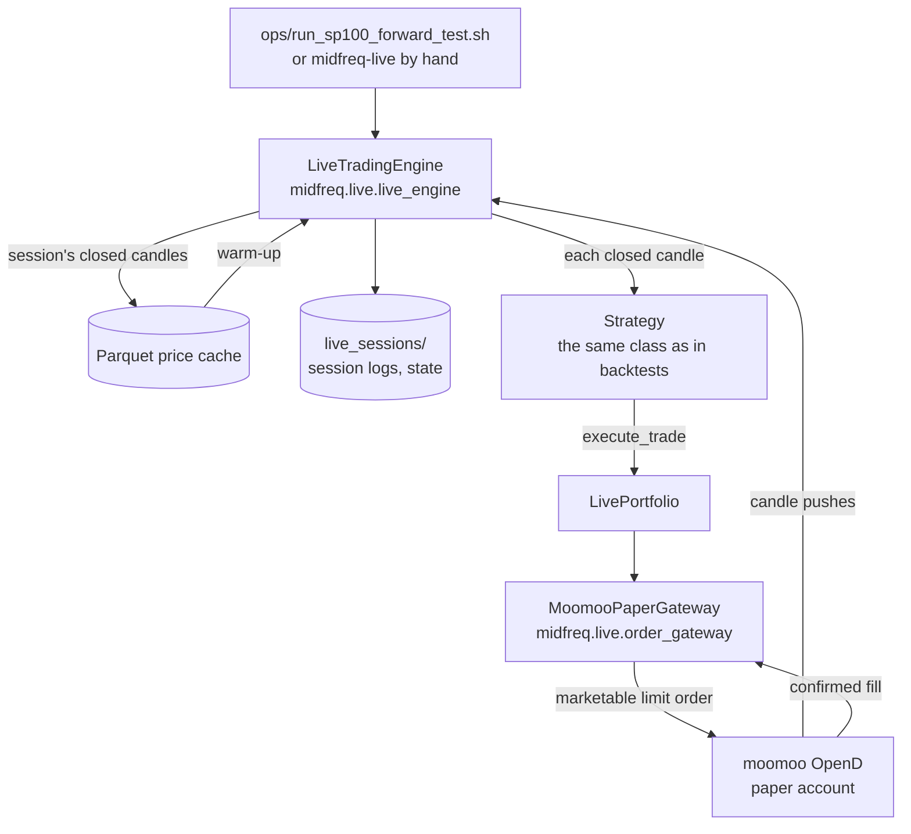

# Live trading

Live trading runs the same strategy classes as backtests against the broker's paper account,
through moomoo OpenD. Sessions run on a Google Cloud virtual machine (the *trading VM*) beside
OpenD, which only the VM can reach, one session each US trading day. The repository holds two
live trading paths, and both write the same records:

| | The trading node | The session runner |
|---|---|---|
| Package | `midfreq.trading` | `midfreq.live` |
| Shape | one process for any number of strategies, with an order management system, pre-trade risk, a position ledger per strategy, one shared market data service and reference data | one process per strategy, which subscribes to its own candles, then places each order and waits for its outcome |
| Reaches the broker | only through connectors: an `ExecutionClient` per account and the data client's streams | through the Moomoo SDK, in its own order gateway |
| Unfilled orders | re-priced, then cancelled, every step journaled | cancelled after 30 seconds |
| Started by | `ops/run_node.sh`, or `midfreq-node run` | `ops/run_sp100_forward_test.sh`, or `midfreq-live` |
| Described in | [The trading node](trading_node.md) | this page |

The trading VM's schedule ([`ops/vm/crontab.txt`](repo:ops/vm/crontab.txt)) starts the US forward
test on the trading node, in paper mode, and keeps the session runner's line, commented as
`#ROLLBACK`, to go back to it; both paths read and write the strategy's state file in the same
format. The forward-test sessions reported under [Results](../results/forward_test.md) were run by
the session runner.

The schedule also starts a Hong Kong session on the node at 09:35 SGT on weekdays
([`config/node_hk.yaml`](repo:config/node_hk.yaml)), on the Hong Kong paper account during Hong Kong
hours. It is an infrastructure test of a second market, not a validated strategy: the Hong Kong
strategy search found nothing fit to trade, and the one strategy that met the validation standard,
the ML Direction Classifier on HSBC, is consistent with luck across its family. It has its own
account, state file and records folder (`live_sessions/hk/`), and stops at 16:02, hours before the
US session starts, so the two never share the account's quote quota.

## The session runner



`LiveTradingEngine` subscribes to OpenD's candle pushes for the session's symbols and feeds
each closed candle to the strategy.

- **Candles.** OpenD pushes an update each time the forming candle changes. A candle is final
  only when a push arrives with a newer timestamp; the previous candle is then passed to the
  strategy, which gives the same one-decision-per-closed-candle rhythm as the backtester. A
  cross-sectional strategy acts as soon as the whole universe has reported a cross-section,
  seconds after the candle closes. If no candle closes for 1.25 candle periods (75 minutes on
  hourly candles), the stall is logged and the engine resubscribes once; if the stream stays
  silent, the session stops cleanly.
- **Warm-up.** At the start of a session the engine replays recent candles from the price cache
  through the strategy, with trading switched off, so its indicators are ready; it falls back to
  the broker's metered historical API only for candles the cache lacks. At the end it writes the
  session's closed candles back into the cache.
- **Capital.** The paper account holds about US$1,000,000, while results were measured on
  US$100,000. A capital cap (`capital_cap`, `--capital`) holds a session to a stated amount, so
  the forward test trades at the size its backtest was established at. The trading node applies
  the same cap from each strategy's `capital`.

### Orders and fills

Strategies are unchanged from backtesting. `LivePortfolio` intercepts `execute_trade`:

1. a buy is rounded down to whole board lots, and trimmed to what the cash can pay at the limit
   price;
2. `MoomooPaperGateway` places a limit order 1% through the latest price (a *marketable* limit:
   moomoo's paper environment does not support true market orders), waits for the fill, and
   cancels any remainder after 30 seconds;
3. only what the broker confirms as filled is booked, at the broker's fill price; an order that
   does not fill books nothing.

Several strategies may share one paper account, so each portfolio claims only the positions it
opened. Ownership is saved to a per-strategy state file at the end of each session and reloaded
at the start of the next, never inferred from the broker's aggregate holdings. The trading node
follows the same rules with the same file
([Positions](trading_node.md#positions)).

<!-- include: packages/midfreq-live/README.md#connection-settings level=3 -->

## Running a session

<!-- include: packages/midfreq-live/README.md#running strip-title -->

Both launchers proceed only within 30 minutes after the market's open when started with
`--scheduled`, end their session just after the close, and print the command without running
it under `DRY_RUN=1`; neither starts while another trading session is running. The trading node
runs the forward test's strategy from its configuration:

```bash
DRY_RUN=1 NODE_CONFIG=config/node_sp100.yaml NODE_MODE=shadow ./ops/run_node.sh
uv run midfreq-node run --config config/node_sp100.yaml --mode shadow --duration 30
```

Any single strategy can be run by hand on the session runner, for example on a Hong Kong stock
during Hong Kong hours:

```bash
uv run python apps/live_runner/run_live.py --strategy "Z-Score Mean Reversion" --symbols HK.00700 --duration 30
```

## Session logs and state

Each session writes, to `live_sessions/`:

| File | Holds |
|---|---|
| `session_<time>_<strategy>_<pid>_<n>.jsonl` | one JSON line per event: `session_start` (with the broker's account totals), every `candle_close`, every `trade` the broker filled, any `stall`, and `session_end` (with the totals again) |
| `console_*.log` | the session's console output; a Traceback or CRITICAL line in it marks the session as crashed on the dashboard |
| `state_<strategy>.json` | the strategy's state between daily sessions: the positions it owns and, for the cross-sectional strategies, the rebalance clock |

The trading node writes the first and third in the same formats, and adds its order journal,
`orders_<date>.jsonl`, and its operations log, `ops_<stamp>_<node>.jsonl`
([Records](trading_node.md#records)).

`midfreq.research.forward_test.load(session_dir)` reads the S&P 100 forward test back from the
session logs alone, without OpenD: its profit or loss (the change in the broker's reported
account total since the test began), every trade with the profit realized on each sale, and its
holdings.

## Two sources, never merged

The dashboard shows live trading from two independent sources side by side, so that one can be
checked against the other:

- **The bot record**: what the bot wrote in its session logs. On the VM these are uploaded to a
  private Cloud Storage bucket every 2 minutes, from which the hosted dashboard mirrors them.
- **The broker account**: what the broker reports, read through the connector's read-only
  account client ([Data and connectors](data.md#account-clients)).

A fill in the bot record should appear among the broker's orders, and the bot's holdings among
the broker's positions; a difference would point to a fault in the bot's record keeping. No API
route combines the two ([HTTP API](../api/http/index.md#two-sources-never-merged)).

### Broker snapshots

Only the VM reaches OpenD, so it also reads the broker accounts and publishes them for the hosted
dashboard. Every 5 minutes, `python -m midfreq.data.snapshots` reads each account marked
`publish: true` in the `accounts` section of `config/connections.yaml` (the moomoo US and Hong
Kong paper accounts), with one connection and four read-only queries per account (balance,
positions, today's orders, order history), one account after another, and never touches a
running session. Each account is written as `broker_<id>.json` beside the session logs: the
account as the API serves it, with the orders of the last 14 days, the time it was read
(`as_of`) and its publisher, and no option or secret. The file is replaced atomically. An account
that cannot be read keeps its previous file, so the dashboard shows the last snapshot and its
age, and the hosted dashboard warns once a snapshot is more than 15 minutes old.

## Checking the live path without a broker

The recorded sessions can be replayed against a simulated broker, which checks that a live path
would have made the same decisions on the candles the live sessions received; both need the
price cache for the warm-up:

```bash
uv run python scripts/live/replay_live_sessions.py                       # the session runner
uv run midfreq-node replay --config config/node_sp100.yaml --data-dir data   # the trading node
```

The tests drive the session runner with a fake gateway and the order gateway with a scripted
trade context and clock, and the trading node with fakes of each venue and a simulated venue, so
they never connect to OpenD ([Testing](../developer_guide/testing.md)).

## Paper only

OpenD's address and trading environment come from the `moomoo` entry of
`config/connections.yaml`, which is the paper environment (`trading_env: simulate`). Real money
would be used only if that entry, or `MIDFREQ_MOOMOO_TRADING_ENV`, said `real` explicitly; an
unrecognized value raises an error rather than being guessed. The scripts that only make sense on
the paper account refuse to run when it says `real`. The trading node adds two more conditions:
its own mode must be `live`, and the account in its configuration must say `environment: live`
([Run modes](trading_node.md#run-modes)).
