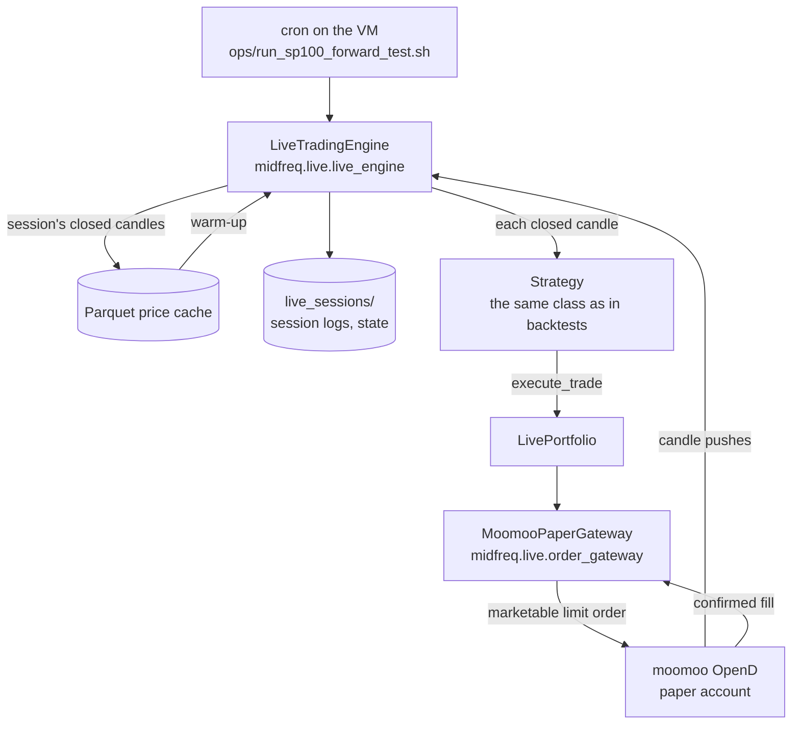

# Live trading

Live trading runs the candle engine, `midfreq-live`, against the broker's paper account through
moomoo OpenD. The strategies are the same classes as in backtests. The engine runs on a Google
Cloud virtual machine (the *trading VM*) beside OpenD, which only the VM can reach; cron starts
one session each US trading day. The venue engine has no live execution client yet, so live
orders stay on this path until the forward test ends.



## The live engine

`LiveTradingEngine` subscribes to OpenD's candle pushes for the session's symbols and feeds
each closed candle to the strategy.

- **Candles.** OpenD pushes an update each time the forming candle changes. A candle is final
  only when a push arrives with a newer timestamp; the previous candle is then passed to the
  strategy, which gives the same one-decision-per-closed-candle rhythm as the backtester. A
  cross-sectional strategy acts as soon as the whole universe has reported a cross-section,
  seconds after the candle closes. If no candle closes for 1.25 candle periods (75 minutes on
  hourly candles), the stall is logged and the engine resubscribes once; if the stream stays
  silent, the session stops cleanly.
- **Warm-up.** At the start of a session the engine replays recent candles from the price cache
  through the strategy, with trading switched off, so its indicators are ready; it falls back to
  the broker's metered historical API only for candles the cache lacks. At the end it writes the
  session's closed candles back into the cache.
- **Capital.** The paper account holds about US$1,000,000, while results were measured on
  US$100,000. A capital cap (`capital_cap`, `--capital`) holds a session to a stated amount, so
  the forward test trades at the size its backtest was established at.

## Orders and fills

Strategies are unchanged from backtesting. `LivePortfolio` intercepts `execute_trade`:

1. a buy is rounded down to whole board lots, and trimmed to what the cash can pay at the limit
   price;
2. `MoomooPaperGateway` places a limit order 1% through the latest price (a *marketable* limit:
   moomoo's paper environment does not support true market orders), waits for the fill, and
   cancels any remainder;
3. only what the broker confirms as filled is booked, at the broker's fill price; an order that
   does not fill books nothing.

Several strategies may share one paper account, so each portfolio claims only the positions it
opened. Ownership is saved to a per-strategy state file at the end of each session and reloaded
at the start of the next, never inferred from the broker's aggregate holdings.

<!-- include: packages/midfreq-live/README.md#connection-settings level=3 -->

## Session logs and state

Each session writes, to `live_sessions/`:

| File | Holds |
|---|---|
| `session_<time>_<strategy>_<pid>_<n>.jsonl` | one JSON line per event: `session_start` (with the broker's account totals), every `candle_close`, every `trade` the broker filled, any `stall`, and `session_end` (with the totals again) |
| `console_*.log` | the session's console output; a Traceback or CRITICAL line in it marks the session as crashed on the dashboard |
| `state_<strategy>.json` | the strategy's state between daily sessions: the positions it owns and, for the cross-sectional strategies, the rebalance clock |

`midfreq.research.forward_test.load(session_dir)` reads the S&P 100 forward test back from these
logs alone, without OpenD: its profit or loss (the change in the broker's reported account total
since the test began), every trade with the profit realized on each sale, and its holdings.

<!-- include: packages/midfreq-live/README.md#running -->

The forward test runs as cron starts it on the VM. The launcher proceeds only within 30 minutes
after the US open, and the session ends just after the close; `DRY_RUN=1` prints the command
without running it. Any single strategy can be run by hand, for example on a Hong Kong stock
during Hong Kong hours:

```bash
uv run python apps/live_runner/run_live.py --strategy "Z-Score Mean Reversion" --symbols HK.00700 --duration 30
```

## Two sources, never merged

The dashboard shows live trading from two independent sources side by side, so that one can be
checked against the other:

- **The bot record**: what the bot wrote in its session logs. On the VM these are uploaded to a
  private Cloud Storage bucket every 2 minutes, from which the hosted dashboard mirrors them.
- **The broker account**: what the broker reports, read through the connector's read-only
  account client ([Data and connectors](data.md#account-clients)).

A fill in the bot record should appear among the broker's orders, and the bot's holdings among
the broker's positions; a difference would point to a fault in the bot's record keeping. No API
route combines the two ([HTTP API](../api/http/index.md#two-sources-never-merged)).

### Broker snapshots

Only the VM reaches OpenD, so it also reads the broker accounts and publishes them for the hosted
dashboard. Every 5 minutes, `python -m midfreq.data.snapshots` reads each account marked
`publish: true` in the `accounts` section of `config/connections.yaml` (the moomoo US and Hong
Kong paper accounts), with one connection and four read-only queries per account (balance,
positions, today's orders, order history), one account after another, and never touches a
running session. Each account is written as `broker_<id>.json` beside the session logs: the
account as the API serves it, with the orders of the last 14 days, the time it was read
(`as_of`) and its publisher, and no option or secret. The file is replaced atomically. An account
that cannot be read keeps its previous file, so the dashboard shows the last snapshot and its
age, and the hosted dashboard warns once a snapshot is more than 15 minutes old.

## Checking the live path without a broker

The recorded sessions can be replayed through the real engine against a simulated broker, which
checks that the engine would have made the same decisions; this needs the price cache:

```bash
uv run python scripts/live/replay_live_sessions.py
```

The tests drive the engine with a fake gateway and the order gateway with a scripted trade
context and clock, so they never connect to OpenD.

## Paper only

OpenD's address and trading environment come from the `moomoo` entry of
`config/connections.yaml`, which is the paper environment (`trading_env: simulate`). Real money
would be used only if that entry, or `MIDFREQ_MOOMOO_TRADING_ENV`, said `real` explicitly; an
unrecognized value raises an error rather than being guessed. The scripts that only make sense on
the paper account refuse to run when it says `real`.
