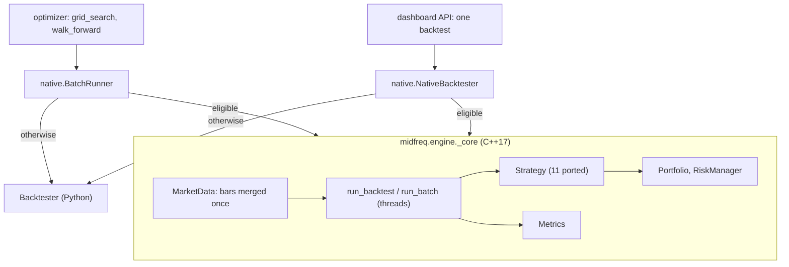

# The C++ engine

The candle backtester's core also exists in C++17, in `packages/midfreq-engine`: the merged event
stream, the event loop, portfolio accounting, the risk rules, the metrics and eleven of the
thirteen candle strategies, behind a pybind11 module. It gives the same results as
[the candle backtester](backtesting.md#the-candle-backtester), trade for trade and bit for bit,
50 to 300 times faster, and a walk-forward about a thousand times faster.

```python
from midfreq.backtest.native import NativeBacktester, make_backtester

# a drop-in for Backtester: same arguments, same metrics, same portfolio afterwards
bt = NativeBacktester(storage, portfolio, risk_manager, slippage_bps=5.0)
metrics = bt.run(CrossSectionalReversal, symbols, Timeframe.HOUR_1, lookback=30, top_n=3)
bt.engine_used, bt.fallback_reason          # "native", None (or "python" and why)

# grid_search and walk_forward take engine="auto" (the default), "native" or "python"
grid_search("Cross-Sectional Reversal", symbols, Timeframe.HOUR_1, start, end, storage, engine="auto")
```

`MIDFREQ_ENGINE=python` turns it off everywhere; `MIDFREQ_ENGINE_THREADS` caps the cores a batch
uses (0, the default, uses them all).



<!-- include: packages/midfreq-engine/README.md#why-the-results-are-identical-not-just-close -->

<!-- include: packages/midfreq-engine/README.md#what-runs-natively-and-what-does-not -->

<!-- include: packages/midfreq-engine/README.md#speed -->

<!-- include: packages/midfreq-engine/README.md#the-trade-offs -->

<!-- include: packages/midfreq-engine/README.md#building-and-testing -->
