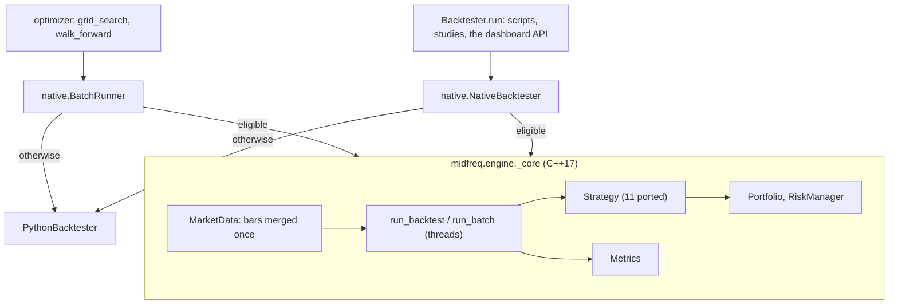

# The C++ engine

The candle backtester's core runs in C++17, in `packages/midfreq-engine`: the merged event
stream, the event loop, portfolio accounting, the risk rules, the metrics and eleven of the
thirteen candle strategies, exposed to Python with pybind11. `Backtester` keeps its Python
interface and hands each run to it; the pure-Python implementation stays as `PythonBacktester`,
the reference the C++ is tested against and falls back to. The results are the same as
[the candle backtester's](backtesting.md#the-candle-backtester), trade for trade and bit for bit:
a 3-year S&P 100 backtest about 50 times faster, a small one 15 to 20 times, and a grid search or
walk-forward several hundred to over a thousand times.

```python
from midfreq.backtest.backtester import Backtester, PythonBacktester

# the same class and arguments as always; the loop now runs in C++
bt = Backtester(storage, portfolio, risk_manager, slippage_bps=5.0)
metrics = bt.run(CrossSectionalReversal, symbols, Timeframe.HOUR_1, lookback=30, top_n=3)
bt.engine_used, bt.fallback_reason          # "native", None (or "python" and why)
Backtester(storage, portfolio, engine="python")   # force the pure-Python implementation

# grid_search and walk_forward take engine="auto" (the default), "native" or "python"
grid_search("Cross-Sectional Reversal", symbols, Timeframe.HOUR_1, start, end, storage, engine="auto")
```

`MIDFREQ_ENGINE=python` turns it off everywhere; `MIDFREQ_ENGINE_THREADS` caps the cores a batch
uses (0, the default, uses them all).



<!-- include: packages/midfreq-engine/README.md#why-the-results-are-identical-not-just-close -->

<!-- include: packages/midfreq-engine/README.md#what-runs-natively-and-what-does-not -->

<!-- include: packages/midfreq-engine/README.md#speed -->

<!-- include: packages/midfreq-engine/README.md#keeping-c-and-python-in-step -->

<!-- include: packages/midfreq-engine/README.md#the-trade-offs -->

<!-- include: packages/midfreq-engine/README.md#building-and-testing -->
