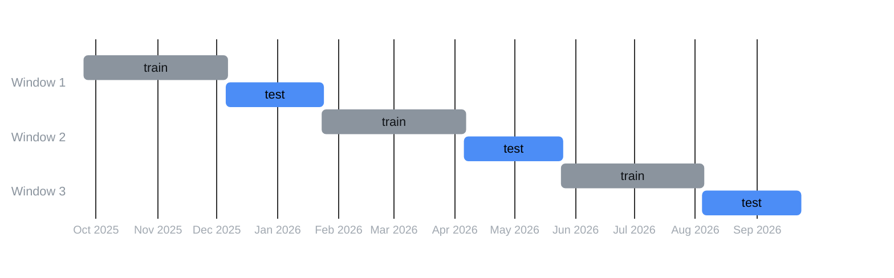

# Optimization and validation

A backtest scores a set of parameters on the data it is run on. If those parameters were chosen
by looking at the same data, by a person or by a search, the score overstates what to expect;
and the more combinations, strategies and universes are tried, the better the best of them
looks by luck alone. The project therefore judges a strategy only by returns on data its
parameters were not chosen on, under two different splits of the data, and then corrects for
the number of candidates it tried.

| Tool | Module | Question it answers |
|---|---|---|
| Grid search | `midfreq.backtest.optimizer.grid_search` | which parameters scored best on this period? |
| Walk-forward | `midfreq.backtest.optimizer.walk_forward` | do the parameters a search picks hold up on the span that follows? |
| Two-configuration standard | the studies in `research/studies/` | does that hold whichever way the period is cut into windows? |
| Probability of Backtest Overfitting | `midfreq.research.overfitting` | within one strategy and universe, is the configuration the search picked better than the others, or the luckiest of them? |
| White's Reality Check | `midfreq.research.reality_check` | across every strategy and universe tried, is the winner better than what trying that many produces? |
| Parameter stability | `research/studies/param_stability_sp100_reversal.py` | does a chosen setting sit on a plateau of good settings, and does that region hold on data the setting was not chosen on? |

## Grid search

`grid_search` backtests every combination of a strategy's parameter grid over one period and
returns them as a DataFrame, best first. The grid is the Cartesian product of the minimum,
maximum and step of each parameter in `STRATEGY_REGISTRY` (`generate_param_grid`); a grid larger
than `max_combinations` (500) is sampled at even intervals. Combinations that made no trade rank
below every combination that did, since a strategy that never enters the market would otherwise
score a neutral objective and outrank active ones.

| Objective | Ranks by |
|---|---|
| `sharpe_ratio` (default) | the annualized Sharpe ratio |
| `return_pct` | the total return |
| `profit_factor` | gross profit over gross loss |
| `max_drawdown` | the maximum drawdown, lowest first |

The commission defaults to the Hong Kong rate, `Portfolio.HK_FEE_RATE`; pass the market's own
rate (`commission_rate=0.00005` for US stocks). A grid search scores the best combination on
the data it was picked from, so its top row is an upper bound, not an estimate.

## Walk-forward

`walk_forward` cuts the period into `n_splits` consecutive windows of equal length. In each, a
grid search (of at most 200 combinations) picks the parameters on the first `train_pct` of the
window, the training span, and they are scored on the rest, the test span, which the search has
not seen. The quickstart's walk-forward of a moving-average crossover on Apple, three windows
with 60% training:



The training span ends where the test span begins, and the training backtest excludes that
day, so no candle is in both. A window whose test span lies mostly beyond the last cached candle
is skipped, and listed in `skipped_windows`, rather than scored as a flat result.

The result holds each window (dates, the chosen parameters, the training and the test metrics)
and a summary:

| Summary | Meaning |
|---|---|
| `avg_oos_return` | the mean test (out-of-sample) return per window: the figure the project judges by |
| `consistency_pct`, `positive_windows` | the share and number of test windows with a positive return |
| `avg_train_return` | the mean training (in-sample) return, for contrast |
| `wf_efficiency` | the test return per day as a share of the training return per day (Pardo, 2008); below about 50% is a warning, and it is undefined when training lost money |

The test spans are shorter than the training spans, which is why the efficiency compares
returns per day rather than per window.

## The two-configuration standard

Every result in the project was held to one standard: a walk-forward over 3 years, run twice
with different cuts.

| | Windows | Training share | Test spans |
|---|---|---|---|
| Config A | 9 | 70% | about 37 days each |
| Config B | 15 | 70% | about 22 days each |

A result **passes** only if, under both Config A and Config B, its mean out-of-sample return per
test window is positive and at least 50% of its test windows are profitable. Requiring both
guards against a result that depends on where the windows happen to fall. The studies write
these four figures for every result (`config_a_oos`, `config_a_consistency`, `config_b_oos`,
`config_b_consistency`) with the verdict (`robust`), and `midfreq.research.results_index`
stacks them into one table: 178 results, of which 27 pass ([Results](../results/index.md)).

## White's Reality Check

Passing the standard is evidence about one candidate. But the candidate that passed was picked
from many, and the best of many edgeless candidates passes some of the time. White's Reality
Check (White, 2000) tests the selection itself:

1. take each candidate's out-of-sample returns per window;
2. centre each candidate on its own mean, so that no candidate has an edge;
3. resample the windows with the stationary bootstrap (Politis and Romano, 1994), which keeps
   neighbouring windows together, and record the largest mean across the candidates;
4. the p-value is the share of resamples whose largest mean is at least the winner's real mean.

`reality_check(candidates, n_boot=5000, mean_block=2.0, seed=12345)` takes
`{name: [return per window]}`; every candidate must have the same windows, because a resample
draws the same windows for all of them. `naive_single_test` applies the same bootstrap to the
winner alone, ignoring that others were tried: the p-value a report would quote if it mentioned
only the winner.

The project ran it over the 8 cross-sectional candidates, reversal and momentum on each of four
universes, with 20,000 resamples: p = 0.094 under Config A and 0.098 under Config B, against
0.058 and 0.015 for the winner tested alone. Both corrected values are above 0.05, so the best
result cannot be told apart from the luck of picking the best of eight.

## Probability of Backtest Overfitting

The Probability of Backtest Overfitting (PBO), by combinatorially symmetric cross-validation
(Bailey, Borwein, López de Prado and Zhu, 2017), asks a narrower question within one strategy and
universe. The period is split into S subsets; for every way of choosing half of them as
in-sample, the configuration that scores best in-sample is found, and its rank among all
configurations on the other half is looked up. PBO is the share of those splits in which the
in-sample winner ranks below the median out-of-sample. Near 0, the search finds something real;
near 0.5, it is a coin flip; above 0.5, it picks configurations that do worse than the median.

`build_performance_matrix` runs the backtests, one per configuration and subset;
`pbo_from_matrix` does the arithmetic on that matrix; `compute_pbo` does both. For the S&P 100
reversal, over 96 configurations and 10 subsets (252 splits), PBO is 0.274.

## Parameter stability

A grid search's best setting may be the top of a broad region of good settings, or an isolated
spike that one period's luck produced. The forward test's setting (lookback 30 candles, a basket
of 3, a rebalance every 19 cross-sections) was the best of the registry's 96-setting grid by
Sharpe ratio over the 84 days to 25 September 2026
([How the settings were chosen](../results/forward_test.md#how-the-settings-were-chosen)), and two
of its three values lie at the edge of that grid, so the grid cannot show which it is. The study
[`research/studies/param_stability_sp100_reversal.py`](repo:research/studies/param_stability_sp100_reversal.py)
extends the grid past both edges and puts the setting to three tests, whose rules were fixed and
committed before the study was run.

It backtests a fine grid of 17,920 settings (lookback 5 to 60, basket 1 to 8, rebalance every 1
to 40 cross-sections), each from a flat portfolio on the forward test's 98 stocks at 0.005% per
side and 5 basis points of slippage, over the 84-day selection window and over the period before
it (25 August 2023 to 2 July 2026), which the setting was not chosen on. On the C++ engine's batch
runner the five surfaces take about a minute. The *neighbourhood* is the 26 settings one step of
the original grid away on each parameter (lookback 25, 30 or 35; basket 2, 3 or 4; rebalance 13,
19 or 25), two of whose values lie outside that grid.

| Test | Passes if | Result |
|---|---|---|
| Plateau | at least 20 of the 26 neighbours score at least 80% of the setting's in-sample Sharpe ratio of 5.49 | **fails**: 2 of 26 |
| Location | the setting with the best smoothed Sharpe ratio on the fine grid (the mean over itself and its neighbours) lies within lookback ±5, basket ±1 and rebalance ±6 of it | **fails**: lookback 36, basket 8, rebalance 15, with a smoothed Sharpe ratio of 4.52 against the setting's 3.17 |
| Generalization | on the earlier period, the median Sharpe ratio of the setting and its neighbours is above 0 and above the median of the whole fine grid | **fails**: 0.65, above 0 but below the grid's 0.96 |


The setting is therefore **not robust**: its in-sample score is not evidence of a stable optimum.
In the selection window it ranks 21st of the 17,920 settings (a Sharpe ratio of 5.49, against a
median of 1.69), but it is a narrow peak: the rebalance interval scores well only at 19 and the
lookback only within a few candles of 30. Before that
window its Sharpe ratio is 0.90, which ranks 9,943rd, below the median setting; by year, it falls
at the 22nd, 21st and 84th percentiles. Two descriptive checks agree:

- **Rebalance phase.** With a rebalance every 19 hourly cross-sections, the first bar decides when
  the rebalances fall. Starting the selection window 0 to 18 bars later gives Sharpe ratios from
  1.21 to 5.62 (median 3.14) and returns from 9.0% to 54.3%; the start the search scored has the
  highest return of the 19.
- **Walk-forward choices.** None of the 24 windows of the S&P 100 walk-forward (Config A and
  Config B) chose the setting, and 2 chose one within its neighbourhood.

A pass would not have validated the strategy; the failure means that the live setting's
in-sample figures say little about what to expect from it, which is what the Reality Check also
found for the strategy as a whole. The study writes every test with its numbers to
`results/param_stability_sp100_reversal_<stamp>.json`, each surface to a CSV beside it, and its
figures to `results/charts/` ([Reproducing the numbers](../results/reproducing.md)).

## What a search over noise looks like

Both corrections can be seen at work on candidates that have no edge by construction:

```python
import numpy as np

from midfreq.research.overfitting import pbo_from_matrix
from midfreq.research.reality_check import naive_single_test, reality_check

rng = np.random.default_rng(7)
trials, alone, corrected, pbos = 200, 0, 0, []
for _ in range(trials):
    # eight candidates with no edge: 15 test windows each, mean 0, 3% of noise per window
    candidates = {f"c{i}": list(rng.normal(0.0, 3.0, 15)) for i in range(8)}
    rc = reality_check(candidates, n_boot=1000, seed=int(rng.integers(1 << 31)))
    best = candidates[rc["best_candidate"]]
    alone += naive_single_test(best, n_boot=1000, seed=int(rng.integers(1 << 31))) < 0.05
    corrected += rc["p_value"] < 0.05
    # 96 configurations scored on 10 subsets of pure noise
    pbos.append(pbo_from_matrix(rng.normal(0.0, 1.0, (10, 96)).tolist())["pbo"])

print(f"best of 8 edgeless candidates called real at 5%: "
      f"tested alone {alone / trials:.0%}, Reality Check {corrected / trials:.0%}")
print(f"PBO of a search over noise: mean {np.mean(pbos):.3f} over {trials} searches")
```

```text
best of 8 edgeless candidates called real at 5%: tested alone 48%, Reality Check 8%
PBO of a search over noise: mean 0.519 over 200 searches
```

Tested alone, the best of eight candidates with no edge is called real in about half the
trials. The Reality Check brings that close to the 5% it is designed for (with only 15 windows
the bootstrap is approximate), and PBO over noise averages one half.

The [Walk-forward a strategy](../tutorials/walk_forward.md) tutorial applies these steps to a
real strategy.
