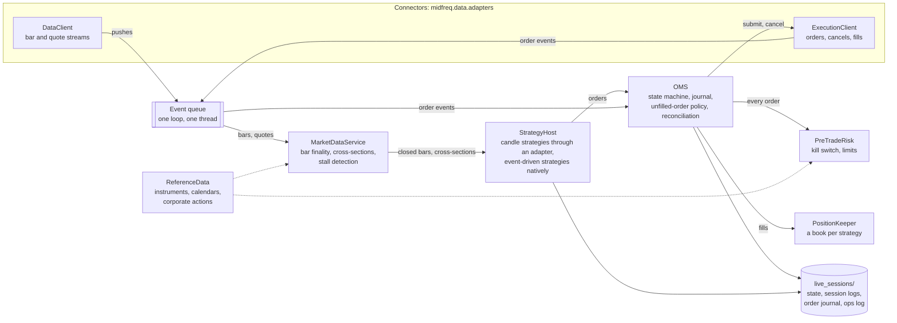

# The trading node

The trading node, `midfreq.trading` (the `midfreq-trading` distribution), is the framework's
live trading system: one long-running process per session that runs strategies against venues
through connectors. An order management system (OMS) owns every order's state and journals it
before it is sent; a pre-trade risk engine checks every order and holds the kill switch; a
position ledger keeps each strategy's books from the fills; one market data service feeds every
strategy; and a reference data service supplies instrument rules, trading calendars and
corporate actions. The strategies are the same classes as in backtests.

The node is pure Python and imports no venue SDK: it reaches a broker or exchange only through
that venue's connector, so a new venue is a new connector and nothing in the node changes. The
design document is [`docs/LIVE_ARCHITECTURE.md`](repo:docs/LIVE_ARCHITECTURE.md); the contracts
between the parts are in [`midfreq.trading.interfaces`](../api/python/midfreq/trading/interfaces.md)
and, towards the venues, [`midfreq.data.adapters.base`](../api/python/midfreq/data/adapters/base.md).

!!! info "Two live paths"
    The repository holds two live trading paths that write the same records: the trading node,
    described here, and the session runner, `midfreq.live`, which runs one strategy per process
    and places its orders through its own Moomoo gateway ([Live trading](live_trading.md)). The
    trading VM's schedule ([`ops/vm/crontab.txt`](repo:ops/vm/crontab.txt)) starts the trading
    node for the US forward test, and keeps the session runner's line for rollback. The
    forward-test sessions reported under [Results](../results/forward_test.md) were run by the
    session runner.



## Principles

1. **One thread owns the state.** Connectors call back on their own threads (a venue SDK's push
   thread, a websocket task), and those callbacks only put items on the node's queue. The OMS,
   risk, positions, market data and strategies all run on the node's single event-loop thread,
   so they need no locks, and a session replays exactly from the same queue items with a test
   clock.
2. **Venues only through connectors.** Only `midfreq.data.adapters.<venue>` imports a venue's SDK
   (`moomoo`, `ccxt`, ...); see [Integrations](../integrations/index.md#trading-through-connectors).
3. **The same strategy code as the backtests.** Candle strategies run unchanged through an
   adapter, as they do in the venue engine; event-driven strategies run natively.
4. **Paper unless told otherwise.** The node starts in shadow mode unless paper or live is asked
   for, and real money needs the live mode and an explicit setting in two places
   ([Run modes](#run-modes)).
5. **Compatible records.** The node writes the strategy state files and session logs in the
   session runner's formats, so the dashboard and the forward-test read-back read either, and a
   strategy can move between the two paths with its state.

## Components

| Component | Module | Responsibility |
|---|---|---|
| **Connectors** | `midfreq.data.adapters.<venue>` | An `ExecutionClient` per account (submit, cancel, fills and refused cancels as events, connection status, open orders and fills for reconciliation) and live streams on the `DataClient` (`subscribe_bars`, `subscribe_quotes`, stream status, the subscription limit) |
| **MarketDataService** | [`midfreq.trading.marketdata`](../api/python/midfreq/trading/marketdata.md) | One subscription per bar type however many strategies want it, within the venue's limit; bar finality; cross-sections per universe; quotes; stall detection; warm-up from the local price cache; the session's bars written to the cache at the end (paper and live only) |
| **ReferenceData** | [`midfreq.trading.refdata`](../api/python/midfreq/trading/refdata.md) | Instruments (lot, tick, currency) from each connector's `InstrumentProvider`, cached; trading calendars per venue; corporate actions |
| **StrategyHost** | [`midfreq.trading.strategy_host`](../api/python/midfreq/trading/strategy_host.md) | Runs the strategies on the bus: candle strategies through `LiveLegacyAdapter`, event-driven ones through `NativeStrategyRunner` |
| **OMS** | [`midfreq.trading.oms`](../api/python/midfreq/trading/oms.md) | The one owner of order state: the state machine, client order ids, routing by venue, the write-ahead journal, order families and the unfilled-order policy, refused cancels, reconciliation with the venues |
| **PreTradeRisk** | [`midfreq.trading.risk`](../api/python/midfreq/trading/risk.md) | The checks every order passes before it is sent, and the kill switch |
| **PositionKeeper** | [`midfreq.trading.positions`](../api/python/midfreq/trading/positions.md) | Each strategy's positions, average prices, cash, realized P&L, commissions and dividends, from the fills; reconciliation with the broker that only ever shrinks a strategy's claim |
| **TradingNode** | [`midfreq.trading.node`](../api/python/midfreq/trading/node.md) | Builds the components from the configuration, runs their lifecycle, and owns the event loop |
| **Ops** | [`midfreq.trading.ops`](../api/python/midfreq/trading/ops.md) | Logging to the console and to a JSON-lines file, the heartbeat, alert sinks |

## The event loop

Every connector callback becomes an item on the node's queue; one loop takes the items in order
and dispatches them:

| Item | Goes to |
|---|---|
| `BarUpdate`, `QuoteTick` | the MarketDataService (a quote also into the cache) |
| `StreamStatus` | the MarketDataService and the ops log; a data stream's `reconnected` also starts a reconciliation |
| `OrderEvent` | the OMS, which journals it, applies it to the order, books fills in the PositionKeeper and publishes it |
| `ExecutionStatus` | the ops log; an execution client's `reconnected` (once it has caught up) starts a reconciliation of orders and positions |
| `TimerEvent` | bar finality, cross-sections and stall detection, and the OMS's unfilled-order policy (every second); reconciliation with the venues (every 5 minutes); the heartbeat (every 5 minutes) |

Timers are queue items too. With the live clock time is the wall clock; with a test clock nothing
moves until the clock is advanced, so a replay or a test is deterministic.

Components talk over the message bus. Closed bars are published on the venue engine's own topic,
`data.bars.<bar_type>`, so an event-driven strategy's `subscribe_bars` receives them exactly as
in a backtest; cross-sections are republished for event-driven strategies as time slices on
`data.slices`; order events go to `events.order.<strategy_id>`, fills also to `events.fills`, and
stream events (connects, gaps, stalls) to `events.stream`.

**Lifecycle.** At start: load the reference data, connect the connectors and execution clients,
restore every strategy's saved state and reconcile orders and positions with the venues, write
`session_start`, warm up from the price cache, subscribe. The loop then runs until the duration
ends, a stop is requested (SIGTERM or SIGINT) or the stream stalls for good. At stop: trading
off, cancel what is still working, make final every bar whose window has elapsed, save state,
write the session's bars to the cache, write `session_end`, disconnect.

## The order management system

`OrderManagementSystem` is the only owner of order state. `submit` returns as soon as the venue's
client has the order; everything the venue says afterwards arrives as an event.

```text
submit(order) -> client order id -> PreTradeRisk -> journal (write-ahead) -> SUBMITTED -> ExecutionClient
venue event (from the queue) -> state machine -> journal -> PositionKeeper (fills) -> bus
timer -> unfilled-order policy (re-price, then cancel)
reconcile() -> the venues' open orders and fills against the journal
```

- **Client order ids** are `<strategy>-<YYYYMMDD>-<seq>`, the sequence restored from the journal
  at start-up so that an id never repeats across restarts.
- **The state machine** applies a legal transition; applies a fill that arrives after a cancel
  or a rejection anyway, because the venue's fill is the truth (the cancel and the fill crossed),
  with a warning; ignores a late or repeated acknowledgement; and reports anything else as an
  error. A fill is applied at most once per (venue, the venue's order id or else the client order
  id, trade id), since some venues number trades per instrument rather than per account.
- **A refused cancel** (`OrderCancelRejected`) changes nothing in the order: the OMS stops waiting
  for that cancel, asks the venue for the order's fills and state, and applies what the venue says.

### The write-ahead journal

`OrderJournal` appends every order, as it is about to be sent or as it was denied, and
everything that happens to it, to `orders_<YYYYMMDD>.jsonl` (one file per UTC day): the order
events with their outcome in the state machine, each send and cancel request, each step of the
unfilled-order policy, the venue's replies and each reconciliation. Every line has the UTC
wall-clock time and the order's full state, including the venue's order id and message. A write
is flushed before the call returns (and synced to disk with `fsync: true`), so a crash loses at
most the line being written, and a torn last line is skipped when the journal is read back. At
start-up the journal rebuilds every order, and a strategy books into its saved state any fill the
journal applied after that state was saved.

### Orders left unfilled

Each order starts a *family*: the order and the child orders that replace it. When the family's
working order has not filled completely `wait_s` after it was sent, the unfilled-order policy
(`UnfilledOrderPolicy`) acts:

1. a limit order is **re-priced**, up to `max_reprices` times: the OMS cancels it, waits for the
   venue's confirmation (never two live orders for the same intent), checks the venue's fills,
   and sends a child order for what the family still has to fill, priced from the quote (the ask
   for a buy, the bid for a sell, `quote_offset_bps` through) or, without a quote, from the last
   price `last_offset_bps` through;
2. after the last re-price, what is left is **cancelled**. A cancel not confirmed within
   `cancel_timeout_s` is checked with the venue and sent again, up to `max_cancel_retries` times.

| Setting | Default | The S&P 100 configuration |
|---|---|---|
| `wait_s` | 30 s | 30 s |
| `max_reprices` | 2 | 2 |
| `quote_offset_bps` | 0 | 0 |
| `last_offset_bps` | 100 (1%) | 100 |
| `cancel_timeout_s` | 30 s | 30 s |
| `max_cancel_retries` | 3 | 3 |

Each step is journaled with the venue's reply. The preset `unfilled_order: original_engine`
reproduces the session runner's order gateway (wait 30 s, no re-price, cancel, wait up to 30 s
for the cancel, no retry); `midfreq-node replay` uses it to compare the two paths' decisions.

### Reconciliation

At start-up, every 5 minutes and after a reconnect, the OMS compares the journal with each venue's
open orders and fills since the journal's lookback: a fill the node missed while it was down or
disconnected is applied, an order the venue still lists open after the node gave up on it is
cancelled at the venue, and orders and fills of other sessions on a shared account are recognized
as foreign and left alone. Positions are reconciled with the broker's holdings only for
instruments with no order in flight, and only ever downwards.

## Pre-trade risk and the kill switch

`PreTradeRiskEngine` checks every order before the OMS sends it. The first check that fails denies
the order, which becomes an `OrderDenied` event with the reason:

1. **kill switch**: while trading is halted, every new order is denied, reducing ones included;
2. the order itself: a positive quantity, and a positive limit price on a limit order;
3. the instrument is known and the quantity is a whole number of lots (Hong Kong board lots, a
   size step for crypto);
4. the venue's trading session is open, by its calendar (holidays and early closes included);
5. a price to value the order: the limit price, else the decision candle's close, else the
   latest pushed price;
6. **price band** (fat finger): a limit price within `price_band_pct` of the reference price;
7. the order's notional within `max_order_notional`;
8. no short selling: a sell no larger than the position less what open sells already sell;
9. for orders that add exposure, the position's notional within `max_position_notional` and the
   strategy's gross notional within `max_gross_notional`, with a warning at `warn_at` of it;
10. a buy's worst-case cost (at its limit, plus `fee_rate` of commission) within the strategy's
    cash less what its open buys have reserved; sells credit nothing until they fill.

Limits are `RiskLimits` fields, set for the node and per strategy in the configuration's `risk`
section. The S&P 100 configuration caps each order and each position at US$50,000 (a holding is
about US$33,300), bands limit prices within 5% of the last price, and requires the session to be
open; its strategy sizes each buy against its own cash, so the engine's cash check is off for it.

**The kill switch.** `TradingNode.halt(reason)` stops trading at once: risk denies every new order,
the OMS pauses its re-pricing, and every working order is cancelled. Trading stays off until
`resume()`. SIGTERM stops a running node the same way (trading off, working orders cancelled,
state saved) before it shuts down, and the end of every session turns trading off in the same
way before the last bars are made final.

## Positions

`PositionLedger`, the PositionKeeper, keeps a book per strategy: positions, average prices, cash,
realized P&L, commissions and dividends, booked from the fills with the same arithmetic as
`midfreq.core.portfolio.Portfolio`, operation for operation, so a fill books the same cash to
the last bit as in a backtest. A strategy's cash starts at its capital cap, whatever the account
holds; several strategies may share one account, so a book is never derived from the broker's
holdings.

- **Fees.** A fill carries the venue's fee. A venue that reports none (Moomoo) marks the fill
  `commission_unknown`, and only then the venue's fee model's estimate from `config/venues.json`
  is booked; a reported 0 stays 0. A fee charged in the base asset (OKX on a spot buy) reduces the
  position rather than the cash. Every booking keeps the venue's own amount and currency.
- **Reconciliation** with the broker's positions only ever shrinks a strategy's claim: a surplus
  at the broker may belong to another strategy, so it is never adopted.
- **Candle strategies** keep their own portfolio as well, the one the state file holds; the
  PositionKeeper's book is made equal to it after the strategy resumes and after each
  reconciliation, and between those both book the same fills.

## Market data

`LiveMarketDataService` is every strategy's only source of bars and quotes. Each venue stream is
opened once, reference counted, and subscriptions are counted against the venue's limit in its
own unit (Moomoo charges one subscription per instrument and data type, so 98 stocks' hourly bars
are 98 of the account's 100).

- **Bar finality.** A forming bar becomes final when a newer push for the same bar type arrives,
  when the venue marks it closed, or by the clock: its close plus a grace (30 seconds for the S&P
  100), once its stream has delivered a push received after that close; a lagging stream gets 10
  minutes, so its last updates are not cut off. A bar that ends a session (Hong Kong's lunch break,
  the close, an early close) waits for the next session's open plus the grace, so no decision is
  taken on it while the market is shut. At stop, every bar whose window has elapsed is made final,
  with trading already off.
- **Cross-sections.** For a strategy that ranks a universe, the bars of one interval are published
  together once every instrument has reported. An incomplete cross-section with at least 90% of the
  universe is decided when a later interval has a final bar; below 90% the interval is reported as
  a gap and not decided.
- **Stalls.** No bar update for 1.25 bar intervals of session time (75 minutes on hourly bars):
  the stream is resubscribed once; if it stays silent, the node stops cleanly.
- **Warm-up and the cache.** Warm-up reads the local price cache only, never the broker's metered
  history. In paper and live mode the session's bars are written back to the cache at the end;
  shadow and sim never write to it.

## Reference data and calendars

`ReferenceDataService` answers what the node needs to know that is not market data:

- **Instruments**: lot, tick and currency from each connector's `InstrumentProvider`, asked once
  per instrument and kept. When a provider cannot answer, the venue's lot rule from
  `config/venues.json` is used and the log says so. Hong Kong prices follow HKEX's spread table
  (`tick_table` in `config/venues.json`), so a limit is always on a valid tick for its price band.
- **Calendars**: `VenueCalendar` per venue, from `config/venues.json`: sessions in the exchange's
  local time (Hong Kong's two, either side of the lunch break), weekdays, `holidays` and
  `early_closes`. Risk asks it whether a session is open; the market data service asks it where a
  session ends.
- **Corporate actions**: dividends and splits from the curated `config/corporate_actions.json`
  and, where a connector reports them, the venue's own cash flows. The PositionKeeper can book
  them; a session does not apply them on its own.

## The strategy host

A **candle strategy** trades by calling `portfolio.execute_trade(...)` and reads its cash and
positions straight after. `LiveLegacyAdapter` gives it a portfolio whose `execute_trade`:

1. does nothing while trading is off (warm-up, shutdown);
2. rounds a buy down to the instrument's lot;
3. prices it at the live market: by default `slip` (1%) through the latest pushed price, or
   through the bid or ask with quotes;
4. trims a buy to what the strategy's cash can pay at the worst case, and a sell to what the
   strategy holds;
5. sends one limit DAY order to the OMS, with the decision candle's close as its reference price.

The strategy's portfolio is booked only from fills, one booking per fill. With `confirm_fills`
(the default) `execute_trade` waits for the outcome of the order's family before it returns,
processing only order events and the OMS's timers meanwhile, so a cross-sectional strategy sizes
its buys on the cash its sells have just raised, as it does in a backtest. `confirm_timeout_s`
must cover the unfilled-order policy's whole budget, which `check-config` checks. Each fill is
written to the session log as a `trade` event and the state file is saved.

An **event-driven strategy** (`midfreq.strategies.trading.Strategy`) runs natively: it receives
bars on its own subscriptions and cross-sections as time slices, submits orders, and learns of
fills from events, as in the venue engine ([Strategies](strategies.md)).

## Run modes

| Mode | Market data | Orders | Records |
|---|---|---|---|
| `shadow` (the default) | the venues' live streams | `ShadowExecutionClient`: each order logged and journaled, never sent; acknowledged then cancelled (`fill_mode: none`, the default), or filled at the quote in the shadow records only (`fill_mode: quote`) | `live_sessions/shadow/` |
| `sim` | recorded data on a test clock | the simulated venue, [`midfreq.trading.testing.sim_venue`](../api/python/midfreq/trading/testing/sim_venue.md): deterministic matching, latency and partial fills | `live_sessions/sim/` |
| `paper` | the venues' live streams | each account's paper environment | `live_sessions/` |
| `live` | the venues' live streams | real money | `live_sessions/` |

- **Live needs two settings.** `--mode live` is refused unless the account in the node's
  configuration says `environment: live` and the connection in `config/connections.yaml` says
  real money as well (`trading_env: real` for Moomoo, `trading_env: live` for ccxt); the node
  also checks that the execution client reports `live` itself. No configuration in the
  repository uses it.
- **One writer per state file.** In paper and live mode a candle strategy must name its state file
  (`state_name`), so that no strategy can take another's state, and a saved state holding
  positions on venues the strategy does not trade is refused. One node runs per records folder,
  under an exclusive lock on `<records>/.node.lock`; the launcher also refuses to start while any
  other trading session runs.
- **Shadow and sim are harmless.** They write to their own records folders, never write bars to
  the price cache, and can never reach a broker's order entry.

## Records

| File | Holds |
|---|---|
| `state_<strategy>.json` | the strategy's positions, its cash under the capital cap and its rebalance clock, in the session runner's format; written atomically and synced |
| `session_<stamp>_<strategy>_<pid>_<n>.jsonl` | `session_start` (with the broker's account totals), every `candle_close`, every `trade`, any `stall`, and `session_end`: the session runner's format, read by the dashboard and `midfreq.research.forward_test` |
| `orders_<YYYYMMDD>.jsonl` | the OMS's journal: every order and event, each policy step, the venues' replies and the reconciliations, with UTC wall-clock times |
| `ops_<stamp>_<node>.jsonl` | the structured operations log |
| `shadow_<YYYYMMDD>.jsonl` | in shadow mode, every order the node would have sent |
| `console_node_<stamp>.log` | the console, written by the launcher |

A rebalance is saved as done before its first order leaves, so a crash in the middle of one does
not make the next session run it again.

## Configuration

A node is configured by one YAML file, `config/node_<name>.yaml`
([`midfreq.trading.config`](../api/python/midfreq/trading/config.md)): its connectors, accounts,
universes and strategies, and one section per component. The forward test's, abridged from
[`config/node_sp100.yaml`](repo:config/node_sp100.yaml):

```yaml
node:
  name: sp100
  mode: shadow                # the schedule passes --mode paper
  timeframe: 1h
  reconcile_s: 300
  stall_factor: 1.25          # no closed bar for 75 minutes: resubscribe once, then stop
connectors:
  moomoo: {}                  # OpenD's host and port from config/connections.yaml
data:
  connector: moomoo
  quotes: false               # bars only: quotes would cost quote quota
accounts:
  moomoo-us:
    connector: moomoo
    options: {market: US}
    environment: paper
strategies:
  - id: sp100-xsr
    class: Cross-Sectional Reversal
    from: config/sp100_forward_test.json      # parameters, symbols and capital
    account: moomoo-us
    state_name: crosssectionalreversal        # the forward test's state file
    commission_rate: 0.00005
    risk_manager: {stop_loss_pct: 0, max_drawdown_pct: 0.15, sizing: equal-dollar}
    pricing: {rule: last, slip: 0.01, time_in_force: DAY}
    confirm_fills: true
    confirm_timeout_s: 150
risk:
  max_order_notional: 50000
  max_position_notional: 50000
  price_band_pct: 0.05
  require_session_open: true
  strategies:
    sp100-xsr: {check_cash: false}
oms:
  unfilled_order: {wait_s: 30, max_reprices: 2, last_offset_bps: 100, cancel_timeout_s: 30, max_cancel_retries: 3}
marketdata:
  min_cross_section_share: 0.9
  finality_grace_s: 30
```

The default components are the factories of
[`midfreq.trading.components`](../api/python/midfreq/trading/components.md), which build the real
classes from their sections:

| Section | Builds | Settings |
|---|---|---|
| `refdata` | `ReferenceDataService` on the connectors' instrument providers | `corporate_actions`, `venues_path` |
| `journal` | `OrderJournal` in the records folder | `directory`, `fsync` |
| `positions` | `PositionLedger`, with each strategy's capital cap and its venue's fee model | `default_capital`, `keep_bookings` |
| `risk` | `PreTradeRiskEngine` | the `RiskLimits` fields, `require_session_open`, per-strategy limits |
| `oms` | `OrderManagementSystem` on the accounts' execution clients | `unfilled_order`, `reconcile_lookback_s`, `reconcile_grace_s`, `journal_lookback_days` |
| `marketdata` | `LiveMarketDataService` on each venue's data client | `min_cross_section_share`, `finality_grace_s`, `limit_unit`, `persist` |

An unknown setting in any section is an error, so a misspelt limit is never silently not applied.
`components:` replaces a factory with another class or factory written to the same protocol, which
is how the tests substitute stand-ins. [`config/node_hk_paper.yaml`](repo:config/node_hk_paper.yaml)
configures Cross-Sectional Reversal on 5-minute bars of six Hong Kong stocks on the Hong Kong
paper account, with its records in `live_sessions/hk_paper/`.

## Operations logging

Every component logs through Python `logging`. The console line carries both clocks, since the VM
runs on Singapore time and the market on New York time:

```text
2026-10-14 21:35:02.911 SGT | 09:35:02 ET | INFO    | node | message
```

`ops_<stamp>_<node>.jsonl` holds the same records as JSON, one per line, with the UTC time, level,
component, session id and context (the cross-section, the client order id, the strategy). Times
come from the node's clock, so a replay logs the replayed time. A heartbeat is logged every 5
minutes. Records at ERROR and above can go to alert sinks, of which an email sink is built in;
they are off unless the configuration turns them on. The Moomoo SDK's own console output is kept
out of the node's console, and its warnings are forwarded into the node's log.

## The `midfreq-node` command

```bash
midfreq-node check-config --config config/node_sp100.yaml        # reads and checks; connects to nothing
midfreq-node run --config config/node_sp100.yaml --mode shadow --duration 30
midfreq-node replay --config config/node_sp100.yaml --data-dir data
```

`check-config` reports every problem in a configuration and whether each component can be
imported:

```text
configuration config/node_sp100.yaml: valid
  node      sp100, mode shadow, timeframe 1h
  account   moomoo-us: connector moomoo, environment paper, options {'market': 'US'}
  strategy  sp100-xsr: CrossSectionalReversal (legacy) on sp100-xsr (98 symbols), account moomoo-us, capital 100,000, params {'lookback': 30, 'top_n': 3, 'rebalance_every': 19}, pricing last slip 0.01
  component refdata       midfreq.trading.components:make_refdata: ok
  component journal       midfreq.trading.components:make_journal: ok
  component positions     midfreq.trading.components:make_positions: ok
  component risk          midfreq.trading.components:make_risk: ok
  component oms           midfreq.trading.components:make_oms: ok
  component marketdata    midfreq.trading.components:make_marketdata: ok
```

`run` starts the node and blocks until the duration ends, a stop signal arrives or the stream
stalls; `--mode` overrides the configuration's. Exit codes: 0 after a clean stop, 1 on a failure,
2 for an invalid configuration. `replay` feeds the candles of the recorded sessions
(`live_sessions/session_*.jsonl`) to a fresh node per recorded day, in sim mode against a
simulated broker, and checks the invariants after every session: the strategy's positions equal
the broker's, no basket larger than its size, every order decided on the cross-section just
completed, the rebalance clock advanced and saved, the capped cash moved as the broker's did, and
no order sent while trading was off. `--reject-every`, `--partial`, `--query-fail-rate` and
`--crash-session` add unfilled orders, partial fills, failing queries and a crash.

On the VM the node is started by [`ops/run_node.sh`](repo:ops/run_node.sh): `NODE_CONFIG` and
`NODE_MODE` choose the configuration and mode, `--scheduled` proceeds only within 30 minutes after
the market's open on a weekday, the session runs until two minutes after the close, and
`DRY_RUN=1` checks the configuration and prints the command without starting anything. The steps
to run it on the VM, check it and roll it back are in
[`docs/NODE_RUNBOOK.md`](repo:docs/NODE_RUNBOOK.md)
([Releases and deployment](../developer_guide/releases_and_deployment.md#startup-checks)).

## Tested equivalence

- **The execution contract.** Every execution client passes the same 13 scenarios against a fake of
  its venue: Moomoo, ccxt with websocket updates, ccxt polling, and the simulated venue
  ([Testing](../developer_guide/testing.md#the-execution-contract)).
- **The same decisions as the session runner.** Built from `config/node_sp100.yaml` with its
  default components and fed the candles of the recorded October sessions, the node makes the same
  decisions as the session runner fed the same candles through its replay harness: the same orders
  (symbol, side, quantity, fill price) on the same decision candles, the same rebalance clock after
  every session, and the same holdings and cash, with every fourth order unfilled, partial fills
  and a crash mid-session added. No order is denied by pre-trade risk, and the PositionKeeper's book
  equals the strategy's own after every session.
- **Taking over a real state.** From the forward test's state file, the node and the session runner
  send the same orders at the same prices at the next rebalance and end with the same clock,
  holdings, cash and state.
- **The boundary.** No package outside the connectors imports a venue SDK, and `lint-imports`
  checks the package layers.

!!! note "Limits"
    - Corporate actions are served and can be booked, but a session does not apply them, and a
      candle strategy's own portfolio has no dividend booking.
    - A candle strategy has two books, its own portfolio and the PositionKeeper's, kept equal by
      copying the first into the second after resume and reconciliation.
    - Shadow mode fills nothing by default, so a shadow strategy holds no basket and its decisions
      diverge after its first rebalance; `fill_mode: quote` needs quotes, which cost quote quota.
    - `sim` mode needs recorded data or a test clock; on live market data, shadow mode is the
      rehearsal.
    - HKEX narrowed some spread-table bands in 2025: the table in `config/venues.json` is to be
      checked against HKEX's current one before Hong Kong trades.
