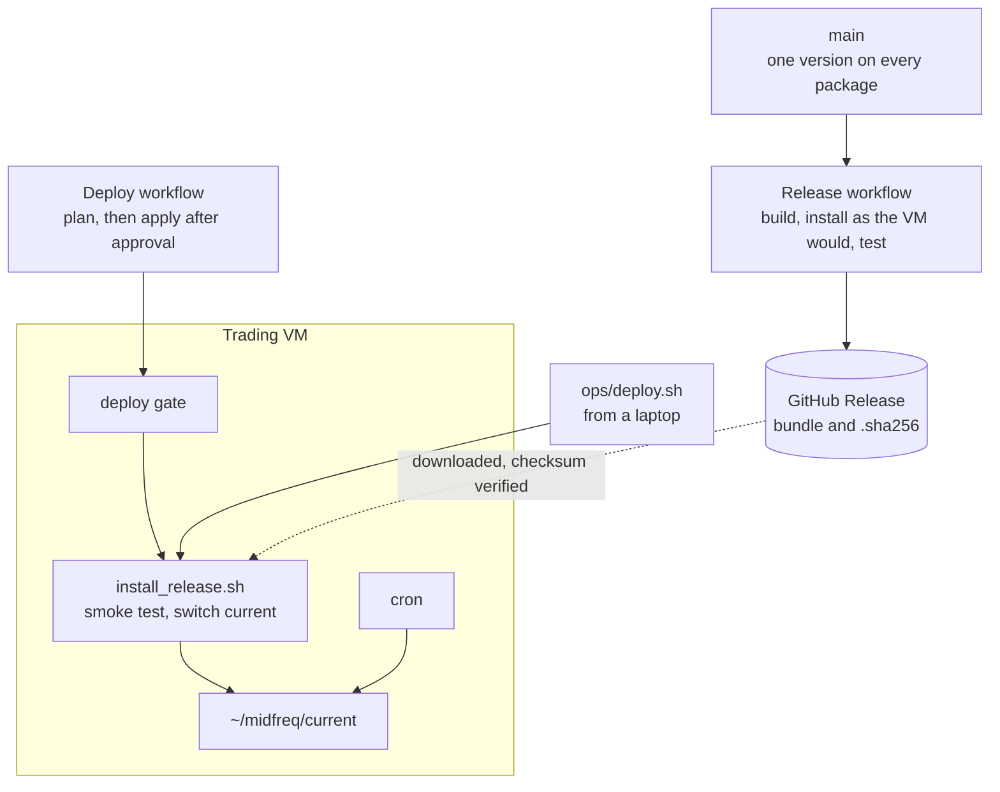
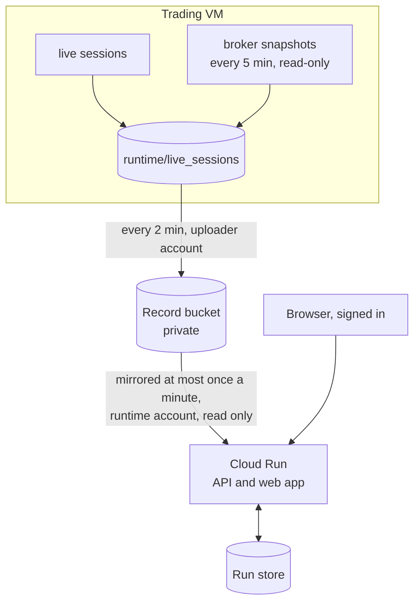

# Releases and deployment

The system runs in three places, each with its own path for code to reach it:

| Component | Runs on | Started by | Code arrives as |
|---|---|---|---|
| Live paper-trading sessions, and the moomoo OpenD gateway they trade through | the **trading VM**, a Google Compute Engine virtual machine | cron (sessions); a systemd service (OpenD) | a versioned release, deployed by hand |
| The hosted dashboard (web app and API) | **Google Cloud Run** | incoming requests; scales to zero | a container image built from committed code |
| This documentation site | **GitHub Pages** | a push to `main` | a build by the Pages workflow |

This page describes roles and procedures. Host addresses, account names, keys and access
bindings are deliberately not published; the operational runbook is
[`ops/README.md`](repo:ops/README.md) in the repository.

## The trading VM

The VM runs the bot's live paper-trading sessions next to moomoo OpenD, the broker's gateway,
which only the VM can reach. Its Python environment is Python 3.10 with the third-party versions
pinned in [`ops/vm/requirements-vm.txt`](repo:ops/vm/requirements-vm.txt), the versions the VM's
OpenD works with. It is not `uv.lock`, which is the research environment on Python 3.12.

### Layout

The VM never pulls code. Each release is installed into its own folder, and code and data are
kept apart: a release never writes to `runtime/`, and nothing in `runtime/` is in git.

```text
~/midfreq/
  releases/<version>/   one folder per release, never modified once installed:
                        its own .venv/, the session launchers (ops/), the configuration as
                        committed (defaults/config/), and a MANIFEST with wheel checksums
  current -> releases/<version>    the release cron runs
  previous              the release current pointed at before the last switch
  runtime/              MIDFREQ_ROOT: config/, data/ (the price cache), live_sessions/ (kept)
  logs/, archive/       operations logs, and their monthly archive
```

### Schedule

The whole schedule is versioned with the code, in
[`ops/vm/crontab.txt`](repo:ops/vm/crontab.txt), and checked by a test. Times are the VM's
clock, Singapore time (SGT).

| When (SGT) | What |
|---|---|
| 21:35 and 22:35, Monday to Friday | The S&P 100 forward test (`ops/run_sp100_forward_test.sh --scheduled`). The US open, 09:30 ET, is 21:30 SGT under daylight saving time and 22:30 SGT otherwise; the launcher proceeds only within 30 minutes after the open, so exactly one of the two starts a session, which ends just after the close |
| 09:25, Monday to Friday (paused) | The Hong Kong roster (`ops/run_daily_candidates.sh`). Paused while the S&P 100 test runs, because the two together exceed the account's 100-symbol subscription quota |
| Every 2 minutes | `ops/vm/sync_logs.sh`: uploads the bot's record to the hosted dashboard's bucket; never deletes |
| Every 5 minutes | `ops/vm/broker_snapshot.sh`: reads each published broker account, read-only, into a snapshot file ([Broker snapshots](../concepts/live_trading.md#broker-snapshots)) |
| Every minute | `ops/vm/memlog.sh`: memory and the largest processes, about 10 days kept |
| 17:05 daily | `ops/vm/maintain.sh`: monthly log archive, retention of OpenD's and the SDK's logs, one health line |

OpenD's address and trading environment come from the `moomoo` entry of
`config/connections.yaml`, which selects the paper-trading environment. Real money would be
used only if that entry, or `MIDFREQ_MOOMOO_TRADING_ENV`, said `real`; neither is set on the VM.

### Migration to releases

Until 15 October 2026 the VM pulled `main` itself each day and pushed its session logs back to
it, so whatever was on `main` traded that night. The migration to versioned releases is in
phases:

| Phase | What | Status |
|---|---|---|
| 0. Cut the GitHub link | The VM's pull and push jobs disabled; the VM keeps trading on the code it has, and session logs are copied to a laptop with `ops/fetch_live_logs.sh` | done, 15 October 2026 |
| 1. Release tooling | Release bundle, installer, deploy script and workflows; CI tests the installed bundle | done, 15 October 2026 |
| 2. Cutover | First release installed, runtime folder created, the versioned schedule installed, log uploads configured | after the forward test |
| 3. Clean up | The pull-based scripts and their CI gate removed | after the cutover |

Until the cutover the VM runs its earlier schedule for the trading session, the memory log and
log clean-up, and the hosted dashboard's record is uploaded from a laptop.

## Releases

A release is a versioned bundle of everything the VM needs to run one version, and nothing
else. It is built and tested by GitHub Actions and published as a GitHub Release.



1. **Version.** `ops/set_version.sh X.Y.Z` sets one version on every package; commit it and push
   `main`.
2. **Release.** Start the Release workflow (Actions, Release, *Run workflow*, with the version),
   or push a tag `vX.Y.Z` ([CI workflows](ci.md#release)).

The bundle, `midfreq-X.Y.Z.tar.gz`, holds:

| Part | Contents |
|---|---|
| `wheels/` | the six packages, all at version X.Y.Z |
| `requirements-vm.txt` | the VM's pinned third-party versions |
| `ops/` | the session launchers, the installer, the VM's schedule and maintenance scripts |
| `defaults/config/` | `config/` as committed, for setting up a runtime folder |
| `MANIFEST` | version, commit, build time and wheel checksums |

## Deploys

A release is deployed by hand, when no session is running, by either of two routes that run the
same installer on the VM:

- from a laptop, `ops/deploy.sh vX.Y.Z` (also `--stage`, `--switch X.Y.Z`, `--rollback`,
  `--status`);
- from GitHub, the Deploy workflow (Actions, Deploy, *Run workflow*), with an action (`status`,
  `deploy`, `stage`, `switch` or `rollback`), a version, and a `force` box for deploying while a
  session runs.

The installer puts the release in `~/midfreq/releases/<version>` with its own environment,
smoke-tests it and, unless the release is only staged, points `current` at it. The new release
trades from the next session; a session already running keeps the code it started with, because
its release folder is never changed. Rolling back points `current` at the previous release again.

The Deploy workflow's `apply` job runs in the protected `production` environment, so it waits
for the owner's approval and runs only from `main`. The key it reaches the VM with is a secret of
that environment, and the VM accepts it for one program only, the deploy gate
([`ops/vm/deploy_gate.sh`](repo:ops/vm/deploy_gate.sh)), which allows `status`, `rollback`,
`switch X.Y.Z` and `deploy X.Y.Z [--stage] [--force]` and nothing else. For a deploy, the VM
downloads the release from GitHub itself and verifies its checksum, so the key never uploads
code; it is also denied a terminal and all port forwarding. Every request is logged on the VM.

## The hosted dashboard

The dashboard runs as a Cloud Run service, separate from the trading VM. One process serves both
the API and the built web app. It is read-only towards the trading system: it reads the bot's
record and the broker snapshots from Cloud Storage and cannot reach OpenD or the bot.

### Build and deploy

`ops/dashboard/deploy_dashboard.sh`, run from a laptop, deploys it:

1. It archives the **committed** code (`git archive HEAD`), so local edits never reach the hosted
   site, and adds the laptop's price cache (`data/`, which is not in git) for backtests.
2. Cloud Build builds the image from [`ops/dashboard/Dockerfile`](repo:ops/dashboard/Dockerfile)
   in two stages: the web app with Node 22, then the API with uv on Python 3.12, installing only
   the API and what it imports. The image also holds `config/`, `results/`, the price cache and
   the dashboard guide. Images are kept in Artifact Registry.
3. The image is deployed to Cloud Run, where it runs as a dedicated runtime service account.

The one-time cloud setup (APIs, the image repository, the record bucket and the runtime
account) is [`ops/dashboard/setup_gcp.sh`](repo:ops/dashboard/setup_gcp.sh).

### Service settings

| Setting | Value | Why |
|---|---|---|
| `MIDFREQ_DASHBOARD_ACCOUNTS` | `snapshots` | no broker gateway is reachable; accounts are shown from the VM's snapshots |
| `MIDFREQ_DASHBOARD_JOBS` | `backtest,compare` | optimizations run hundreds of backtests, so they are left to a local install |
| `MIDFREQ_DASHBOARD_MAX_JOBS` | `1` | one run at a time for all visitors |
| `MIDFREQ_LIVE_SESSIONS` | the record bucket | the bot's record (below) |
| `MIDFREQ_RUNS` | a bucket for saved runs | the run store (below) |
| `MIDFREQ_DASHBOARD_RUN_DELETE` | `off` | visitors cannot delete saved runs |
| `MIDFREQ_AUTH` | `firebase` | sign-in (below) |
| Instances | at most one, scaling to zero | jobs are held in one process's memory |
| CPU | not throttled between requests | a background run continues after its request has returned |

### Sign-in

The hosted dashboard is private. Visitors sign in with Google, through Google Identity Platform
(Firebase Authentication); no password is held anywhere in the system. The API checks the
Firebase ID token on every `/api` route except the health check and the sign-in configuration,
and admits only the accounts on an access list of email addresses and exact domains. A
signed-in account that is not on the list sees *Awaiting approval*. The access list exists only
in the service's settings, never in the repository. The web app's own files stay public, since
they hold no data and the sign-in page must load. The one-time setup is
[`ops/dashboard/setup_auth.sh`](repo:ops/dashboard/setup_auth.sh); the API's side is described
under [HTTP API](../api/http/index.md#sign-in).

### Buckets and service accounts



| Bucket | Holds | Written by | Read by |
|---|---|---|---|
| **Record bucket**: private, with public access prevented | the bot's record, `live_sessions/`: session logs, console logs, strategy state and broker snapshots | the VM, every 2 minutes, through a dedicated uploader service account that may only read and write objects in this bucket; nothing is ever deleted | the dashboard's runtime service account, which may only read this bucket |
| **Run store** | the runs saved by the dashboard's jobs ([Saved runs](../concepts/saved_runs.md)), at `MIDFREQ_RUNS` | the dashboard | the dashboard |

Each service account has one role: the VM's uploader has access to the record bucket only, and
the dashboard's runtime account may read that bucket but not write to it. Until the
[cutover](#migration-to-releases), the record bucket is filled from a laptop after the logs are
copied from the VM.
