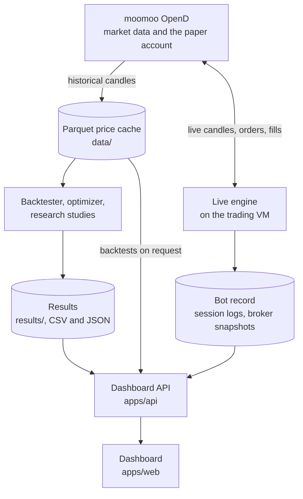

# Quantitative trading bot for mid-frequency stock trading

This site documents the software of the NTU final-year project *Development of a Quantitative
Trading Bot for Mid-Frequency Stock Trading* (CCDS25-1040), by Seow Jia Xian Jackson, supervised
by Prof Chng Eng Siong. It describes how the system is organized, how it is deployed and
operated, and the HTTP API behind its dashboard.

- **Live dashboard:** <https://midfreq-dashboard-123943780205.asia-southeast1.run.app>, with the
  live paper trading, every research result and backtests on request. No installation is needed.
- **Source code:** <https://github.com/JacksonSeowJX/midfreq-trading-bot>

## What the project is

The project builds and evaluates a trading bot for hourly (mid-frequency) trading of Hong Kong
and US equities, using the moomoo OpenAPI for both market data and paper trading.

The system covers the whole path from data to orders: market data download and storage, a
backtester with each market's trading costs, walk-forward validation, tests for
overfitting, a live paper-trading engine that runs unattended on a cloud virtual machine, and a
dashboard over all of it.

The research question was whether any systematic strategy shows a real, tradable edge on these
markets once it is tested properly. After 13 strategies on 4 stock universes, the answer reached
is that none does.

## Results in brief

| Measure | Result |
|---|---|
| Strategies implemented | 13: trend following, mean reversion, pairs trading, regime switching, cross-sectional reversal and momentum, an ML direction classifier, and buy-and-hold with a risk overlay |
| Stock universes | 19 Hong Kong stocks, 15 large US stocks, the S&P 100, and the Hang Seng Index (88 stocks) |
| Validation standard | Walk-forward over 3 years, split two ways: Config A with 9 windows and Config B with 15, each 70% training and 30% test. A result passes only if, under both splits, its mean out-of-sample return per test window is positive and at least 50% of its test windows are profitable |
| Results held to that standard | **217**, of which **13 passed** (6%) |
| Strongest result | Cross-sectional reversal on the S&P 100. It passes at the broker's real fee of 0.005% per side, with +5.73% (Config A) and +0.63% (Config B) mean return per test window, and a Probability of Backtest Overfitting (PBO) of **0.274** over 96 configurations (pure noise gives 0.5) |
| Corrected for the search | White's Reality Check over the 8 cross-sectional candidates gives **p = 0.094** (Config A) and **p = 0.098** (Config B), above the 5% needed. **No result survives the correction**: the best cannot be told apart from the luck of picking the best of eight. It also passes or fails depending on the week its data ends |
| Live trading | Paper trading from a Google Cloud virtual machine: Hong Kong single-stock strategies from July to September 2026, then a forward test of S&P 100 reversal on a US$100,000 allocation from 28 September 2026 |

No strategy beat chance once the number of things tried was accounted for, and the single-stock
strategies did not beat simply holding the same stocks. What the project delivers is the
framework, a validation method that catches results a single backtest would have reported as
real, and a live system checked against a real broker. The [dashboard guide](dashboard.md#example-b-the-13-results-that-pass-and-the-correction-for-the-search)
walks through these figures on the live dashboard.

## The system in one picture

## Contents

| Page | What it covers |
|---|---|
| [Architecture](architecture/index.md) | The six packages and their import layers, the data flow from the broker gateway to results, the live trading path, and the venue-based engine |
| [Packages](packages/index.md) | One page per package, from its README |
| [API](api/index.md) | The design of the dashboard's HTTP API, its routes, and the [full reference](api/reference.md) rendered from its OpenAPI contract |
| [Dashboard](dashboard.md) | The dashboard guide: every view, and five examples that reproduce the main findings |
| [Deployment](deployment.md) | The trading VM and its schedule, versioned releases and deploys, CI workflows, and the hosted dashboard |
| [Development](development.md) | Setting up the workspace with uv, tests, the API contract, CI, the release process and this site |
