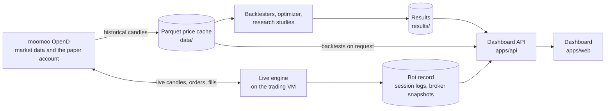

---
hide:
  - navigation
  - toc
---

# midfreq trading bot

A Python framework for researching, validating and paper trading mid-frequency (hourly)
strategies on Hong Kong and US equities. It covers the whole path from market data to orders:
connectors and a Parquet price cache, two backtesting engines with each market's trading costs,
walk-forward validation with corrections for the number of things tried, a live engine that
trades through a broker's paper account, and a dashboard over all of it.

[Get started](getting_started/index.md){ .md-button .md-button--primary }
[Read the results](results/index.md){ .md-button }

The software was built for the NTU final-year project *Development of a Quantitative Trading Bot
for Mid-Frequency Stock Trading* (CCDS25-1040), by Seow Jia Xian Jackson, supervised by
Prof Chng Eng Siong. Its venue-based engine follows the design of
[NautilusTrader](https://nautilustrader.io); it is an independent implementation, not that
library.

## Where to start

- **[Architecture](concepts/architecture.md)**: the six packages, the layers they import across,
  and how data flows from the broker's gateway to results.
- **[Backtesting](concepts/backtesting.md)**: the candle backtester the research used, the
  event-driven venue engine, fill and slippage models, and trading costs.
- **[Optimization and validation](concepts/optimization_and_validation.md)**: grid search,
  walk-forward, the two-configuration standard, White's Reality Check and the Probability of
  Backtest Overfitting.
- **[Live trading](concepts/live_trading.md)**: the live engine, the order gateway, session logs,
  and the reconciliation of the bot's record against the broker's.

## Documentation

-   :material-rocket-launch-outline:{ .lg .middle } **Getting started**

    ---

    Install the workspace with uv, then run a backtest and a walk-forward in a few lines of
    Python or in the dashboard.

    [:octicons-arrow-right-24: Getting started](getting_started/index.md)

-   :material-book-open-variant:{ .lg .middle } **Concepts**

    ---

    Architecture, data and connectors, instruments and venues, strategies, backtesting,
    validation, live trading, saved runs and the dashboard.

    [:octicons-arrow-right-24: Concepts](concepts/index.md)

-   :material-school-outline:{ .lg .middle } **Tutorials**

    ---

    Step-by-step walkthroughs whose code runs as shown: a backtest, a walk-forward, an
    event-driven strategy and a new connector.

    [:octicons-arrow-right-24: Tutorials](tutorials/index.md)

-   :material-connection:{ .lg .middle } **Integrations**

    ---

    Moomoo OpenD, Interactive Brokers, yfinance, Binance and ccxt: capabilities, symbology,
    setup and limits of each connector.

    [:octicons-arrow-right-24: Integrations](integrations/index.md)

-   :material-code-braces:{ .lg .middle } **API reference**

    ---

    The Python API, generated from the packages' docstrings, and the HTTP API behind the
    dashboard, rendered from its OpenAPI contract.

    [:octicons-arrow-right-24: API reference](api/index.md)

-   :material-wrench-outline:{ .lg .middle } **Developer guide**

    ---

    The development environment, tests, CI workflows, releases and deployment, and how this
    site is built.

    [:octicons-arrow-right-24: Developer guide](developer_guide/index.md)

-   :material-chart-line:{ .lg .middle } **Results**

    ---

    What the research found: 217 results held to the validation standard, 13 passed, and none
    survived the correction for the search. The live forward test.

    [:octicons-arrow-right-24: Results](results/index.md)

-   :material-github:{ .lg .middle } **Source code**

    ---

    The repository on GitHub: the packages, the applications, the research studies and the
    operations scripts.

    [:octicons-arrow-right-24: JacksonSeowJX/midfreq-trading-bot](https://github.com/JacksonSeowJX/midfreq-trading-bot)

## The system in one picture

| | |
|---|---|
| Packages | Six installable packages in one `midfreq` namespace: core, data, strategies, backtest, live, research |
| Markets | Hong Kong (HKEX) and US (Nasdaq, NYSE) equities, hourly bars; seven equity venues and four crypto exchanges configured |
| Connectors | Moomoo OpenD, Interactive Brokers, yfinance, Binance, ccxt |
| Strategies | 13 candle strategies behind one registry; an event-driven Strategy API with native strategies |
| Validation | Walk-forward under two configurations, White's Reality Check, Probability of Backtest Overfitting |
| Live trading | Paper trading through moomoo OpenD from a cloud virtual machine, recorded and reconciled against the broker |
